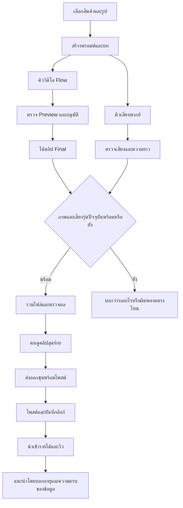

# Angle — แผนการผลิตสื่อและความน่าเชื่อถือ (30 Tickets)

เอกสารนี้เป็นรายละเอียดส่วนหนึ่งของ [แผนทั้งระบบ](angle-system-master-plan.md) ไม่ใช่ Master Plan ทั้งแอป รหัส Ticket เดิมคงไว้เพื่ออ้างอิงต่อได้

วันที่: 15 ตุลาคม 2026 · สถานะ: **ร่างให้ผู้ใช้พิจารณา ยังไม่เริ่ม implementation**

## 1. เป้าหมายและวิธีอ่าน

ทำให้มั่นใจว่า “คลิปพร้อมโพสต์” ใช้ภาพและบทที่ถูกต้อง กู้การทำงานต่อได้ และลดเวลาที่ต้องเฝ้าจอ

แผนนี้ปรับจากเอกสาร `angle-360-system-analysis.md`, `angle-modernization-roadmap.md` เทียบกับโค้ดปัจจุบันและเอกสารใน repo ไม่ถือสถานะ Completed ในเอกสารเดิมเป็นหลักฐานว่าผ่าน UAT แล้ว

บริบทจาก `docs/backlog.md`: สินค้าใหม่ 3–5 ตัว/วัน และกลับมาเคลียร์ checkpoint เป็นชุดวันละ 1–2 รอบ จึงยังไม่ให้การทำหลาย angle ของสินค้าเดิมเป็นงานแรก หากเป้าหมายธุรกิจเปลี่ยนสามารถสลับลำดับได้

แต่ละ Ticket มี Goal เดียว, ขอบเขตเล็ก, Flow และ UAT แบบ **เตรียม → ทำ → ต้องเห็น** เลข Ticket เป็นลำดับอ้างอิง ไม่ได้หมายความว่าต้องปล่อยทีละใบ ทุกใบเริ่มสถานะ **รอพิจารณา**

คำว่า “ผ่านระบบ” = ไฟล์ถูกต้องตามเงื่อนไขทางเทคนิค ส่วน “ตรวจแล้ว” = คนดูภาพ ฟังเสียง และเห็นว่านำไปโพสต์ได้ ทั้งสองอย่างต้องแยกกัน

## 2. ระบบหลังปรับ



### กติกาที่เสนอ

1. วิดีโอยาวเท่าไรให้คงภาพครบเท่านั้น ไม่บังคับทุกไฟล์ต้อง 10 วินาที และไม่ให้เสียงสั้นทำภาพหาย
2. เสียงอัตโนมัติมุ่งไม่เกิน `min(ค่าที่ตั้ง, ความยาววิดีโอจริง - ระยะเผื่อ)` เมื่อรู้ความยาววิดีโอแล้ว ระยะเผื่อเริ่มเสนอ 0.2 วินาทีและปรับจากการฟังจริง
3. ค่าที่ตั้ง 9.6 วินาทีหมายถึงเพดานเสียง 9.6 จริง ไม่หัก 0.4 ซ้ำ เสียงสั้นกว่านั้นไม่ต้องยืด
4. เพดานเร่งเสียงเริ่มเสนอ 1.25 เท่า หากยังเกินให้แก้บท/สร้างเสียงใหม่โดยคนกด ไม่ตัดคำหรือจ่าย API ซ้ำเองไม่จำกัด
5. เสียงพังไม่ขวาง Flow; Flow พังไม่ทำเสียงที่สำเร็จแล้วหาย
6. งานเดิม/ไฟล์เดิมยังเปิดดูได้ แต่ห้ามใช้ไฟล์ที่ไม่รู้รุ่นเป็นหลักฐานว่า “พร้อมโพสต์ล่าสุด”
7. การส่งออกพร้อมโพสต์อัตโนมัติเลือก Final ที่คนอนุมัติและดาวน์โหลดสำเร็จก่อน หากโหลด Final ไม่สำเร็จ คนเลือกใช้ Preview 720p ที่อนุมัติแล้วได้เป็นรายครั้ง โดยแสดงขนาดจริงและตรวจคลิปรวมก่อนส่งออก ไม่ downgrade เงียบ โหมด “ทำต่อเอง” ยังส่งวัตถุดิบได้
8. ไม่เปลี่ยน Flow เป็น API, ไม่เพิ่มหลายบัญชี, ไม่ย้ายฐานข้อมูลหรือเพิ่ม Redis ในแผนนี้

### หน้าจอที่เสนอในแท็บผลลัพธ์เดิม

```text
สถานะงาน: รอสร้างเสียงใหม่
ภาพ       Final รุ่น 3     ผ่านระบบ
เสียง     บทเปลี่ยนแล้ว    [สร้างเสียงใหม่]
คลิปรวม   รุ่นก่อนหน้า     [ดูฉบับเก่า]

[ดูคลิปปัจจุบัน]  [ส่งออกพร้อมโพสต์ — ยังใช้ไม่ได้]
[ส่งวัตถุดิบไปทำต่อเอง]

เมื่อทุกอย่างผ่าน:
สถานะงาน: รอคุณตรวจคลิป
[เล่นคลิป]  [ตรวจแล้ว]  →  [ส่งออกพร้อมโพสต์]
```

### โครงสร้างภายในที่เสนอ

- ใช้ SQLite เดิมเพิ่มทะเบียน `MediaAsset` สำหรับไฟล์ที่ตรวจแล้ว: entry, ชนิด, path, hash, ระยะเวลา, job/attempt ต้นทาง, บท/การตั้งค่าและ asset ต้นทางที่ใช้สร้าง
- เพิ่ม `MediaTask` สำหรับงานเสียง/รวมไฟล์: input fingerprint, สถานะ, attempt, lease, error และ output asset งานหนึ่งมีผลสำเร็จที่อ้างอิงได้หนึ่งชุด
- ใช้ background process ฝั่ง local สำหรับงานเสียงและ FFmpeg แยกจากลูปควบคุมเบราว์เซอร์ Flow เพื่อไม่ให้เสียงค้างแล้วคิว Flow ค้าง
- ไฟล์แต่ละรุ่นมีชื่อไม่ซ้ำภายใต้ path ที่สร้างผ่าน `lib/upload-paths.ts`; ไฟล์ชั่วคราวยังไม่เป็น asset พร้อมใช้
- โมดูลกลางตัดสินว่า asset ใด “ปัจจุบันและใช้ได้” เว็บ, worker และ exporter เรียกกติกาเดียวกัน ไม่ใช้ `existsSync` เพียงอย่างเดียว
- ไม่เปลี่ยนสถานะ Flow นอก `lib/flow-lifecycle.ts`; สถานะ media เป็นอีกวงจรหนึ่ง ไม่ยัด TTS ทุกขั้นเข้า FlowJob
- การตั้งค่ายังอยู่ JSON ได้ แต่เขียนแบบ atomic และคัดลอกค่าที่ใช้จริงลงงานแต่ละครั้งเพื่ออธิบายผลย้อนหลังได้

รายละเอียด schema/migration ต้องตรวจอีกครั้งตอนลงมือ; การเพิ่มตารางทดสอบกับ DB สำเนาเท่านั้น ผู้ใช้เป็นผู้ deploy migration ของ DB จริง

## 3. ภาพรวมชุดส่งมอบ

| ชุด | Tickets | ผลที่ตรวจได้ | ลำดับ |
|---|---|---|---|
| A ความถูกต้องของสื่อ | M01–M06 | ภาพครบ เสียงไม่เกิน และ error ไม่เงียบ | ทำก่อน |
| B ไม่ใช้ไฟล์ผิดรุ่น | V01–V06 | เปลี่ยนบท/เรนเดอร์ใหม่แล้วไม่ส่งไฟล์เก่า | ต่อจาก A |
| C ทำเบื้องหลังและกู้ต่อ | Q01–Q04 | เสียงกับภาพทำคู่กัน รีสตาร์ตแล้วตามงานได้ | ต่อจาก B |
| D ป้องกันงานหาย | B01–B03 | สำรองครบและทดลองกู้ได้ | ทำคู่กับ A ได้ |
| E รู้ว่าควรปรับตรงไหน | O01–O03 | เห็นเหตุผลวาดซ้ำและเวลารอคน | ก่อนเพิ่ม AI |
| F ทางลัดรูปเดิม | F01–F03 | ทดลอง angle ใหม่โดยข้ามเฉพาะขั้นที่เหมาะ | เลือกทำ |
| G AI ช่วยลดความผิดพลาด | I01–I02 | เตือนความยาก/ช่วยชื่อเมื่อจำเป็น | หลังมีข้อมูล |
| H อ่านรายได้อย่างถูกต้อง | R01–R03 | ข้อมูลสดพอหรือไม่ และเปรียบเทียบอย่างมีบริบท | เลือกทำตามความถี่นำเข้า |

## 4. Tickets ชุด A — ความถูกต้องของสื่อ

### M01 — ตรวจความพร้อมเครื่องก่อนสร้างเสียง

**Goal:** ผู้ใช้รู้ทันทีว่าเครื่องยังสร้างเสียงไม่ได้เพราะอะไร

**ขอบเขต:** ตรวจ API key ว่ามีโดยไม่แสดงค่า, FFmpeg/ffprobe เรียกได้, โฟลเดอร์ชั่วคราวเขียนได้; มี timeout สำหรับการตรวจ ไม่เรียก API เสียเงิน

**Flow:** กดสร้างเสียง → ตรวจเครื่อง → พร้อมจึงเริ่ม / ไม่พร้อมบอกวิธีแก้

**UAT:** จำลองไม่มี FFmpeg → กดสร้างเสียง → เห็น “ไม่พบ FFmpeg” และไม่มีการเรียกสร้างเสียง; เครื่องพร้อม → ผ่านไปขั้นสร้างได้ ไม่มี key ปรากฏบนจอหรือ log

**พึ่งพา:** ไม่มี · **จุดแก้:** tts-engine และ action/ข้อความสถานะ

### M02 — คงภาพครบเมื่อเสียงสั้น

**Goal:** เสียงจบก่อนแล้วภาพยังอยู่ครบ

**ขอบเขต:** เติม silence ท้ายเสียง; ยึดความยาววิดีโอจริงและตรวจ output ไม่ยึด 10 วินาทีตายตัว

**Flow:** ภาพ 10s + เสียง 6s → รวม → ภาพครบ 10s, ท้ายไม่มีเสียงพูด

**UAT:** ใช้คลิปที่ท้ายมีวัตถุทดสอบ → รวมเสียงสั้น → ยังเห็นวัตถุนั้นตอนท้าย; คลิป 8s → ผลยาวประมาณ 8s ภายในคลาดเคลื่อนที่กำหนดจาก frame/container ไม่เติมภาพเป็น 10s

**พึ่งพา:** M01 · **จุดแก้:** video-merge

### M03 — เสียงเกินให้แก้บทแทนเร่งจนฟังไม่รู้เรื่อง

**Goal:** ไม่มีเสียงที่ยาวเกินถูกจัดว่าใช้ได้อัตโนมัติ

**ขอบเขต:** แก้ความหมาย 9.6 ให้ตรงค่าตั้ง; จำกัด tempo ตามกติกา; เก็บ tempo ที่ใช้จริง; วัดผลหลังแปลง; เสียงเกินแสดง “บทพากย์ยาวเกิน” ไม่รวม/ไม่ตัดคำ

**Flow:** สร้างเสียง → ตัดเงียบ → เร่งได้ในเพดานหรือไม่ → ผ่าน / ขอแก้บท

**UAT:** เสียง 20s เป้าหมาย 9.6s → ไม่เร่งเป็น 2 เท่าและประกาศผ่าน; เสียง 10s → ผ่านเมื่อผลจริงไม่เกิน 9.6s ตาม tolerance; ตั้ง 8.5s → ใช้เพดาน 8.5 ไม่ใช่ 8.1

**พึ่งพา:** M01 · **จุดแก้:** tts-engine และข้อความ error

### M04 — ปฏิเสธไฟล์เสียงหรือคลิปที่เสีย

**Goal:** ไฟล์ว่าง/อ่านไม่ได้ไม่กลายเป็นผลสำเร็จ

**ขอบเขต:** ffprobe ตรวจ stream, duration เป็นเลขบวก, เสียงมี audio, คลิปรวมมี video+audio; ตรวจปลายทางหลัง merge และ timeout ทุก subprocess/API; ไม่รับรองเนื้อหาคำพูดจาก probe

**Flow:** ได้ไฟล์ → ตรวจ → ผ่านจึงประกาศสำเร็จ / ไม่ผ่านแสดง error

**UAT:** ไฟล์ 0 byte และ response ไม่มีเสียง → ขึ้นล้มเหลว ไม่แสดงพร้อมโพสต์; จำลอง FFmpeg ค้าง → จบด้วย timeout และลองใหม่ได้

**พึ่งพา:** M02, M03 · **จุดแก้:** media validation กลาง

### M05 — แจ้งข้อผิดพลาด TTS/merge ให้ผู้ใช้เห็น

**Goal:** ผู้ใช้รู้ว่าวิดีโอเสร็จแต่เสียงไม่เสร็จ

**ขอบเขต:** อ่าน `{ok:false}` ของ action ทุกจุด ไม่รอเฉพาะ exception; แจ้งเสียง/merge แยกจากสถานะ Flow; ข้อความไม่เปิดเผย key หรือ raw response ที่อ่อนไหว

**Flow:** Flow สำเร็จ + TTS พัง → “วิดีโอพร้อม / เสียงล้มเหลว” → ลองสร้างเสียงใหม่

**UAT:** จำลอง API 429 → เห็นเหตุขัดข้องที่เข้าใจได้หลัง refresh และ Flow ไม่ถูกประกาศล้มเหลวตาม; merge ล้มเหลว → ไม่แจ้งว่าได้คลิปรวมแล้ว

**พึ่งพา:** M04 · **จุดแก้:** actions, read model, production panel

### M06 — บันทึกการตั้งค่าโดยไม่ทำไฟล์เสีย

**Goal:** บันทึกหรือรีสตาร์ตกลางทางแล้วการตั้งค่ายังอ่านได้

**ขอบเขต:** ตรวจค่าบน server, serialize การอัปเดตจากหน้าเว็บ, เขียน temp แล้ว rename; config เสียต้องแจ้งใช้ค่าเริ่มต้น ห้ามเงียบจนผู้ใช้เข้าใจว่าค่าตนยังอยู่

**Flow:** แก้ค่า → ตรวจ → บันทึกครบชุด → แสดงค่าที่บันทึกจริง

**UAT:** ส่งค่า duration ผิด → ปฏิเสธพร้อมข้อความ; จำลองล้มก่อน rename → ค่าชุดก่อนยังอ่านได้; เปิดสองแท็บแก้คนละค่า → ไม่ทำ JSON ขาดหรือทับค่าที่ไม่เกี่ยวข้องโดยไม่ตรวจรุ่น

**พึ่งพา:** ไม่มี · **จุดแก้:** tts-settings, settings action

## 5. Tickets ชุด B — ไม่ใช้ไฟล์ผิดรุ่น

### V01 — เก็บคลิปแต่ละงานไม่ให้ทับกัน

**Goal:** เริ่ม FlowJob ใหม่ใน entry เดิมแล้วคลิปงานก่อนยังอยู่

**ขอบเขต:** ชื่อ/path คลิปแยก job+attempt รวม Final; อัปเดตตัวอ่านและ exporter; รองรับ legacy path เดิมแบบอ่านได้ ไม่ย้าย/ลบไฟล์เก่าโดยพลการ

**Flow:** งาน A เสร็จ → เริ่มงาน B → เก็บคนละไฟล์ → เปิด A ได้

**UAT:** สร้างสองงานใน entry เดียว → checksum คลิป A ไม่เปลี่ยน; Final เก่าเปิดได้; export ไม่อนุมาน 1080p จากชื่อ `r3-final.mp4` เพียงอย่างเดียวอีก

**พึ่งพา:** ไม่มี · **จุดแก้:** Flow download/lifecycle metadata, queries, clip-export

### V02 — ผูกเสียงกับบทและค่าที่ใช้สร้าง

**Goal:** รู้ว่าเสียงใดตรงกับบทปัจจุบัน

**ขอบเขต:** เพิ่มทะเบียน asset และ fingerprint ของ script+voice+style+duration+model/processing version; ไฟล์เสียง immutable; ไฟล์เก่าไม่มี metadata แสดง “ยังไม่ยืนยันรุ่น” จนสร้าง/ตรวจรับตามทางเลือกที่ชัดเจน

**Flow:** สร้างเสียงจากบท A → บันทึกรุ่น → เปลี่ยนเป็นบท B → เสียง A กลายเป็นรุ่นเก่า

**UAT:** แก้บท → เสียงเก่ายังฟังได้แต่ไม่พร้อมรวมอัตโนมัติ; เปลี่ยน voice → ต้องสร้างเสียงใหม่; แก้ caption อย่างเดียว → เสียงไม่กลายเป็นเก่า

**พึ่งพา:** M04 · **จุดแก้:** schema ทดสอบ, media assets, actions

### V03 — ผูกคลิปรวมกับภาพและเสียงที่ใช้จริง

**Goal:** เปลี่ยนภาพหรือเสียงแล้วคลิปรวมเก่าไม่ถูกเลือกอัตโนมัติ

**ขอบเขต:** manifest อ้าง video asset+audio asset+merge settings; resolver กลางใช้ร่วมเว็บ/worker/export; ตรวจไฟล์ยังอยู่และ input ตรงรุ่น ไม่ fallback เงียบไปของเก่า

**Flow:** ภาพ A + เสียง A → รวม A → เปลี่ยนเสียง B → รอรวมใหม่

**UAT:** มี `r3-merged.mp4` เก่าค้าง → ไม่ถูกถือว่าปัจจุบันเพียงเพราะมีไฟล์; คลิป Preview ถูกแทนด้วย Final → ต้องรวมใหม่; ไฟล์ input หาย → แจ้งไฟล์หาย

**พึ่งพา:** V01, V02 · **จุดแก้:** media resolver, flow-queries, clip-export-fs

### V04 — กันการรวมซ้อนและผลเก่าทับผลใหม่

**Goal:** เว็บกับ worker ทำงานพร้อมกันแล้วผลล่าสุดไม่เสีย

**ขอบเขต:** จองงานตาม fingerprint/lease, ไฟล์ temp ต่อ task, ตรวจ output ก่อน rename, publish แบบ compare-and-set เฉพาะ input ปัจจุบัน; cleanup เฉพาะ temp ของ task นั้น

**Flow:** สองคำขอ input เดียว → งานเดียว → publish ครั้งเดียว

**UAT:** ยิงสองคำขอพร้อมกัน → มี output สำเร็จชุดเดียว; เปลี่ยนบทระหว่างรวม → ผลเก่าถูกเก็บเป็นประวัติแต่ไม่เป็นคลิปปัจจุบัน; kill FFmpeg → ไฟล์พร้อมใช้เดิมไม่เสีย

**พึ่งพา:** V03 · **จุดแก้:** MediaTask/locking, merge service

### V05 — ส่งออกซ้ำแล้วได้ฉบับล่าสุดครบชุด

**Goal:** โฟลเดอร์ที่จะหยิบไปโพสต์ตรงกับฉบับที่เห็นในแอป

**ขอบเขต:** export fingerprint รวม video/audio/script/caption/hashtags; เปลี่ยนเสียงแม้ชื่อวิดีโอเดิมก็อัปเดต; staging+manifest ปิดท้ายเพื่อตรวจชุดไม่ครบ; ไม่ลบไฟล์ที่ผู้ใช้เพิ่มเอง; failure ไม่ประกาศส่งออกสำเร็จ

**Flow:** ส่งออก A → เปลี่ยนเสียงเป็น B → รวม B → ส่งออกที่เดิม → ได้ B

**UAT:** เปิดไฟล์ปลายทางหลังส่งซ้ำ → ได้เสียง B จริง; ปลายทางถูกล็อก → แจ้งไม่สำเร็จและไม่มีป้ายชุดพร้อม; ไฟล์ส่วนตัวที่ผู้ใช้วางในโฟลเดอร์ยังอยู่

**พึ่งพา:** V04 · **จุดแก้:** clip-export, clip-export-fs

### V06 — แสดงความพร้อมและการตรวจโดยคน

**Goal:** มองครั้งเดียวรู้ว่าส่งออกพร้อมโพสต์ได้หรือยัง

**ขอบเขต:** ป้ายภาพ/เสียง/คลิปรวม/ส่งออก; ปุ่ม “ตรวจแล้ว” ผูกกับ output fingerprint; เปลี่ยน output ให้ตรวจใหม่; เลือก Final ก่อน แต่กรณี Final โหลดไม่ได้คนเลือก approved Preview 720p ได้ชัดเจนเป็นรายครั้ง ส่วน “ส่งวัตถุดิบไปทำต่อเอง” ไม่ถูกบล็อกและไม่เรียกพร้อมโพสต์

**Flow:** รวมผ่านระบบ → ดู/ฟัง → ตรวจแล้ว → ส่งออกพร้อมโพสต์

**UAT:** เสียงเก่า → บอก “บทเปลี่ยนแล้ว” และปิดปุ่มพร้อมโพสต์; Preview ยังไม่อนุมัติ → ดูได้/ส่งวัตถุดิบได้; Final ผ่านและตรวจแล้ว → ส่งออกได้; Final โหลดพังแต่คนเลือก Preview ที่ผ่านแล้ว → ตรวจ/ส่งออก 720p ได้พร้อมป้าย; เปลี่ยนเสียง → ธงตรวจเดิมใช้ไม่ได้

**พึ่งพา:** M05, V05 · **จุดแก้:** production-panel, read model, export gate ฝั่ง server

## 6. Tickets ชุด C — เบื้องหลังและกู้ต่อ

### Q01 — สร้างและจองงานสื่อที่กู้ต่อได้

**Goal:** งาน TTS/merge ไม่หายเมื่อปิดหน้าเว็บ

**ขอบเขต:** MediaTask queued/running/succeeded/failed/cancelled พร้อม input fingerprint, attempt, lease expiry; จองแบบ atomic; งานซ้ำใช้ผลเดิมเมื่อ input ตรงและไฟล์ยังผ่านตรวจ; จำกัดหนึ่ง TTS และหนึ่ง merge พร้อมกันเริ่มต้น

**Flow:** ขอเสียง → บันทึกงาน → worker จอง → บันทึกผล

**UAT:** กดซ้ำเร็ว ๆ → ไม่เกิด API call ซ้ำของ input เดียว; สอง worker แย่งงาน → มีหนึ่งตัวได้สิทธิ์; ปิดแท็บ → งานยังมีสถานะให้อ่าน

**พึ่งพา:** V04 · **จุดแก้:** task repository + media worker แยกจาก Flow browser

### Q02 — ปล่อยเสียงและ Render ทำงานคู่กัน

**Goal:** เสียงช้าไม่ขวางคิววิดีโอ

**ขอบเขต:** หลังบันทึกพรอมต์ส่ง `promptReady()` และ enqueue TTS แบบอิสระ; ไม่ await synthesis ใน generate action; ปิด auto-TTS แล้วยัง Render ได้; บันทึกงานสำเร็จก่อนตอบ UI

**Flow:** พรอมต์พร้อม → คิว Flow + คิวเสียง → แต่ละฝั่งเดินต่อเอง

**UAT:** จำลอง TTS ช้า 60s → Flow เข้าคิวโดยไม่รอครบ; TTS พัง → Flow ยังไป checkpoint ได้; สร้าง caption ไม่สำเร็จ → พรอมต์และงานที่บันทึกแล้วไม่หาย

**พึ่งพา:** Q01 · **จุดแก้:** generateWithAI และ lifecycle integration

### Q03 — รวมเมื่อทั้งสองฝั่งพร้อมด้วยกติกาเดียว

**Goal:** ลำดับที่เสียงหรือภาพเสร็จก่อนไม่ทำให้พฤติกรรมต่างกัน

**ขอบเขต:** reconcile กลาง enqueue merge เมื่อ Final ปัจจุบัน+เสียงปัจจุบันพร้อมและ auto-merge เปิด; preview merge สำหรับดูตัวอย่างต้องแยก stage; ไม่เลือกไฟล์ตาม mtime

**Flow:** เสียงก่อน/Final ก่อน → ตรวจ asset → enqueue merge เดียวกัน

**UAT:** สลับลำดับเสร็จสองแบบ → ได้ output และสถานะเหมือนกัน; เปิด auto-merge ตอนทั้งคู่พร้อม → เกิดหนึ่งงาน; ปิดไว้ → ต้องกดรวมเอง

**พึ่งพา:** Q02 · **จุดแก้:** media reconciliation, Flow completion hook

### Q04 — รีสตาร์ตแล้วบอกสถานะจริงและลองต่อได้

**Goal:** ไม่มีงานติด “กำลังทำ” ถาวรหลังโปรเซสล้ม

**ขอบเขต:** start/stop จัดการ media worker ของตนและกันซ้อน; lease หมดแล้วตรวจ output; การเรียก TTS ที่ไม่รู้ว่าฝั่งผู้ให้บริการสำเร็จหรือยังแสดง “ไม่ทราบผล ลองใหม่อาจคิดเงินซ้ำ” ไม่ยิงใหม่เอง; merge ในเครื่อง retry ได้จำกัด; script เปลี่ยนแล้วไม่กู้ input เก่ามา publish

**Flow:** โปรเซสล้ม → เปิดใหม่ → ตรวจงานค้าง → กู้ผล / รอคนลองใหม่

**UAT:** kill หลัง API ส่งแต่ก่อนรับผล → ไม่จ่าย API ซ้ำอัตโนมัติ; kill ระหว่าง merge → กู้หรือลองใหม่ได้; เปิด start ซ้ำ → ไม่เพิ่ม worker ซ้อน

**พึ่งพา:** Q03 · **จุดแก้:** media worker recovery, start/stop, UI retry

## 7. Tickets ชุด D — สำรองและกู้คืน

### B01 — สร้างชุดสำรองที่ข้อมูลสัมพันธ์กัน

**Goal:** ได้ DB และไฟล์ที่อ้างถึง ณ จุดสำรองครบ

**ขอบเขต:** ใช้ SQLite online backup ไม่ copy เฉพาะ `.db` ที่มี WAL; รวบรวม uploads/config/media manifests ด้วย snapshot/retry verification; ถ้าไฟล์ legacy ยังเปลี่ยนให้แจ้งเลื่อน snapshot แทนรับรองชุดไม่ครบ; รวม fingerprint/checksum และ exclude .env/profile จากชุดทั่วไป ต้องมีวิธีกู้ secrets/session แยกที่เข้าถึงจำกัด

**Flow:** กดสำรอง → snapshot DB → copy/verify ไฟล์อ้างอิง → ชุดสำรองผ่าน

**UAT:** สร้างไฟล์งานระหว่างสำรอง → DB backup ผ่าน integrity check และทุกไฟล์ที่อ้างว่าครบตรวจเจอ; ดิสก์เต็ม → แจ้งล้มเหลว ไม่แสดงชุดนั้นเป็น backup ใช้ได้

**พึ่งพา:** ไม่มี แต่ทำง่ายขึ้นหลัง V01–V04 · **จุดแก้:** script backup แบบอ่าน production ได้โดยไม่แก้ข้อมูลจริง

### B02 — ทดลองกู้คืนในพื้นที่แยก

**Goal:** พิสูจน์ว่าชุดสำรองใช้ทำงานต่อได้

**ขอบเขต:** restore ไป DB/uploads/config แยกทั้งหมด; ต้องเพิ่ม override root ของ uploads ผ่าน upload-paths ก่อน; เริ่มแอปที่ 3051 ไม่เริ่ม Flow/media worker อัตโนมัติ ไม่เชื่อมโปรไฟล์จริงหรือส่งออก Desktop จริง

**Flow:** เลือก backup → กู้เข้า sandbox → เปิดตัวอย่างสินค้า/ภาพ/เสียง/คลิป

**UAT:** เปิด entry ตัวอย่างสามแบบและเล่นสื่อได้; checksum/mtime ของ DB กับ uploads จริงไม่เปลี่ยน; backup ขาดไฟล์ → รายงานรายการที่ขาดและไม่ผ่าน restore drill

**พึ่งพา:** B01 · **จุดแก้:** isolated storage configuration, restore script/runbook

### B03 — แสดงอายุและผลสำรองล่าสุด

**Goal:** รู้ว่ามี backup ที่ตรวจแล้วล่าสุดเมื่อไร

**ขอบเขต:** สถานะสำรองล่าสุด, verified restore ล่าสุด, ขนาดพื้นที่ว่าง, ปุ่มสำรอง; retention ไม่ลบชุดสุดท้ายที่ผ่าน; ค่าแนะนำเก็บรายวัน 7 ชุด/รายสัปดาห์ 4 ชุดต้องดูขนาดจริงก่อนเปิดอัตโนมัติ และเลือกปลายทางคนละดิสก์เมื่อมี

**Flow:** เปิดตั้งค่า → ดู “สำรองล่าสุด/กู้ทดสอบล่าสุด” → สำรองเมื่อจำเป็น

**UAT:** backup ล้มเหลววันนี้ → วันสำเร็จล่าสุดไม่ถูกอัปเดต; ไม่เคยทดลองกู้ → แสดงตามจริง; retention simulation → ชุดสุดท้ายที่ผ่านยังอยู่

**พึ่งพา:** B02 · **จุดแก้:** settings status และ retention script

## 8. Tickets ชุด E — วัดก่อนเพิ่มฟีเจอร์

### O01 — เก็บเหตุผลที่ขอทำใหม่

**Goal:** แยกภาพเพี้ยนออกจากปัญหาเน็ตหรือเปลี่ยนใจ

**ขอบเขต:** ตัวเลือกไม่บังคับ “สินค้าเพี้ยน / ฉากไม่ตรง / การเคลื่อนไหว / เสียง / ปัญหาทางเทคนิค / อื่นๆ”; ใช้ log เดิมเท่าที่ทำได้; failure อัตโนมัติเป็นอีกประเภท ไม่อนุมานเหตุผลจาก redo อย่างเดียว

**Flow:** กดวาดใหม่ → เลือกเหตุผลหรือข้าม → ทำงานต่อ

**UAT:** ข้ามเหตุผล → ยังวาดใหม่ได้; เลือกสินค้าเพี้ยน → รายงานแสดงถูก round/attempt; เน็ตหลุด → ไม่นับเป็นสินค้าเพี้ยน

**พึ่งพา:** ไม่มี · **จุดแก้:** redo UI, FlowActivity/media activity

### O02 — สรุปเวลารอและจำนวนรอบต่อคลิป

**Goal:** รู้ว่าติดคอขวดที่เครื่องหรือรอคน

**ขอบเขต:** เวลา queue, machine processing, checkpoint waiting, จำนวน redo และจำนวนงานได้ Final/ส่งออก; เวลาเปิดหน้าจอไม่เรียกว่าเวลาที่คนทำงานจริง; ถ้าต้องการ attended time ใช้การจับเวลาหรือบันทึกตัวอย่างโดยสมัครใจ

**Flow:** ดูรายงาน → เห็น “รอคนเลือกรูป 3 ชม.” แยก “Render 4 นาที”

**UAT:** งานรอเลือกภาพข้ามคืน → ไม่ถูกนับเป็นเวลาคนทำงาน 8 ชม.; ขาด timestamp → แสดงข้อมูลไม่พอ ไม่ใส่ 0; before/after เทียบกลุ่มสินค้าใหม่กับทำซ้ำแยกกัน

**พึ่งพา:** O01 · **จุดแก้:** activity aggregation/read-only report

### O03 — แสดงต้นทุนการผลิตโดยบอกสิ่งที่ยังไม่รู้

**Goal:** เปรียบเทียบความคุ้มค่าโดยไม่แต่งตัวเลขกำไร

**ขอบเขต:** จำนวน API call/render/redo + ต้นทุนประมาณจากอัตราที่ผู้ใช้กำหนดและวันที่อัตรา; แสดงต้นทุนที่ยังไม่ทราบ; เงินสุทธิโดยประมาณต้องระบุไม่รวมอะไร; ไม่เทียบเครดิต Flow กับบาทอัตโนมัติโดยไม่มีฐานคำนวณ

**Flow:** เปิดคลิป → ดูเงินจ่ายแล้ว + ต้นทุนที่ทราบ + ต้นทุนยังไม่ทราบ

**UAT:** ไม่มีอัตราราคา → แสดงจำนวนครั้งและ “ยังคำนวณต้นทุนไม่ได้” ไม่ใส่ศูนย์; เปลี่ยนอัตรา → ระบุประมาณใหม่หรือคง snapshot เดิมอย่างชัดเจน ไม่แก้ประวัติแบบเงียบ

**พึ่งพา:** O02, V02 · **จุดแก้:** cost configuration + report

## 9. Tickets ชุด F — ใช้รูปเดิมอย่างปลอดภัย (เลือกทำ)

### F01 — เลือกวิธีทำ angle ใหม่

**Goal:** คนเลือกได้ว่าจะใช้รูปเดิมมากน้อยแค่ไหน

**ขอบเขต:** บน flow ทำสำเนาเดิมเพิ่มสามตัวเลือก: สร้างใหม่ทั้งหมด / ใช้รูปสินค้ารอบ 1 แล้วสร้างรอบ 2 / ใช้สองรูปเดิม; แสดง thumbnail และที่มา; เปิดใช้ต่อเมื่อ F02–F03 พร้อม

**Flow:** ทำ angle ใหม่ → เลือกวิธี → ดูรูป → ยืนยัน

**UAT:** ไม่มีรูปผ่าน → เลือกใช้สองรูปไม่ได้พร้อมเหตุผล; angle รถยนต์แต่รูปเดิมโต๊ะ → ผู้ใช้เห็นรูปก่อนตัดสินใจ ไม่ข้ามอัตโนมัติ

**พึ่งพา:** V01, V03 · **จุดแก้:** duplicate/entry workspace/photo library

### F02 — ติดรูปที่เลือกไปกับงานใหม่โดยไม่แตะต้นฉบับ

**Goal:** งานใหม่มี reference ที่ชัดเจนและแก้ได้อิสระ

**ขอบเขต:** copy/reference แบบ immutable พร้อม provenance; ตรวจไฟล์และสินค้าต้นทาง; รักษา duplicatedFromId; รูปที่ลบหรือไม่ตรงสินค้าต้องปฏิเสธ; ยังไม่เริ่ม Render

**Flow:** ยืนยันรูป → สร้าง entry ลูก + reference → ตรวจข้อมูลครบ

**UAT:** แก้/ลบรูปของงานลูก → ต้นฉบับยังอยู่; ไฟล์หายระหว่างเลือกกับยืนยัน → ปฏิเสธก่อนสร้างงานครึ่งชุด; lineage รายได้ยังรวมเป็นตระกูลเดิม

**พึ่งพา:** F01 (UI ยังซ่อน), V02 · **จุดแก้:** duplicate transaction/files, photo provenance

### F03 — เข้ารอบที่ถูกต้องและยังตรวจ Preview ตามเดิม

**Goal:** ข้ามเฉพาะการวาดรูปที่ไม่จำเป็น

**ขอบเขต:** transition ผ่าน lifecycle กลาง; สองรูปพร้อม → รอพรอมต์ใหม่แล้ว R3; รูป R1 อย่างเดียว → R2; ไม่หยิบพรอมต์ angle เก่ามาเรนเดอร์; ไม่ข้ามอนุมัติ Preview/Final; attachment ต้องผ่าน driver contract จริงก่อนเปิด

**Flow:** สองรูปเดิม + พรอมต์ใหม่ → R3 → ตรวจ Preview → Final

**UAT:** ยังไม่มีพรอมต์ใหม่ → ไม่ Render; พร้อมครบ → ไม่มีการสร้าง R1/R2; สินค้าภาพไม่เหมาะ → กลับทางสร้างใหม่ได้โดยไม่แก้ entry ต้นฉบับ

**พึ่งพา:** F02 · **จุดแก้:** lifecycle, enqueue, driver integration

## 10. Tickets ชุด G — AI ช่วยแบบให้คนตัดสินใจ

### I01 — เตือนความเสี่ยงพร้อมวิธีทำให้ปลอดภัย

**Goal:** ผู้ใช้เห็นวิธีลดภาพเพี้ยนก่อนเสียรอบ Render

**ขอบเขต:** เริ่มกฎที่อธิบายได้จากชนิดสินค้า/productSpec เช่น กลไก/ของเหลว/สะท้อนแสง; ใช้ safeMode เดิม; AI เพิ่มได้ภายหลังเมื่อวัดว่ากฎไม่พอ; ไม่ auto-trash และไม่เปลี่ยนโหมดเงียบ

**Flow:** ได้สเปก → “สินค้ามีกลไก แนะนำโชว์คงรูป” → ใช้คำแนะนำ / ทำแบบเดิม

**UAT:** ของพับได้ → เห็นเหตุผลและเลือกเองได้; สเปกไม่พอ → บอกไม่แน่ใจ ไม่มั่นใจสูงปลอม; เตือนผิด → ข้ามได้และบันทึก feedback

**พึ่งพา:** O01–O02 · **จุดแก้:** risk helper + brief UI

### I02 — ใช้ภาพช่วยย่อเฉพาะชื่อที่กำกวม

**Goal:** ลดชื่อผิดชนิดโดยรักษารุ่นและจำนวนที่สำคัญ

**ขอบเขต:** ต่อจาก short-name pipeline เดิม; ชื่อข้อความชัดใช้ทางเดิม; กำกวมและมีภาพจึงส่งภาพ; รูปไม่มี/อ่านไม่ได้ fallback ข้อความ; เก็บชื่อเต็มและให้คนแก้; ไม่เปลี่ยนชื่อระหว่าง Flow กำลังใช้อยู่

**Flow:** ชื่อกำกวม → ดูภาพประกอบ → เสนอชื่อสั้น → ใช้/แก้

**UAT:** “ชุดแก้ว 6 ใบ” + ภาพมีใบเดียว → ไม่สรุปเหลือขายหนึ่งใบ; ภาพล้มเหลว → งานไม่ค้างถาวร; คนแก้ชื่อขณะ AI คิด → AI ไม่ทับชื่อที่แก้

**พึ่งพา:** O02, M04 แนว timeout · **จุดแก้:** gemini, short-name-db

## 11. Tickets ชุด H — วิเคราะห์รายได้ตามข้อมูลที่มี

### R01 — แสดงความสดและความครอบคลุม

**Goal:** รู้ก่อนเชื่อคำแนะนำว่าข้อมูลพอหรือยัง

**ขอบเขต:** ใช้ ImportLog เดิม แสดงเวลา orders/clips แยก, จำนวนคลิปที่ match, จำนวน entry ที่ยังไม่มี metric, คำเตือน top-15; จำนวนไฟล์ครบไม่เท่ากับคลิปครบ; ไม่มี snapshot ไม่ตีเป็น 0

**Flow:** เปิดรายได้ → ดูสถานะข้อมูล → ดูคำแนะนำพร้อมข้อจำกัด

**UAT:** อัปครบสามไฟล์แต่ยังขาดคลิป → ไม่แสดง “ครอบคลุมทุกคลิป”; orders เก่า/clips ใหม่ → เตือนเฉพาะ orders; คลิปไม่มีแถว → แสดงไม่มีข้อมูล

**พึ่งพา:** ไม่มี · **จุดแก้:** dashboard view/import status

### R02 — เปรียบเทียบ angle ด้วยช่วงเวลาที่เข้ากัน

**Goal:** ไม่ประกาศผู้ชนะจากตัวเลขที่เทียบกันไม่ได้

**ขอบเขต:** รวมตระกูลผ่าน duplicatedFromId; แสดงอายุคลิป, จำนวนตัวอย่าง, เงินจ่ายแล้ว/รอ, วิวและช่วงวัด; ไม่คำนวณ RPM ข้าม window ที่ไม่ตรง; ตรวจความหมาย CSV จากตัวอย่างจริงก่อน หากยืนยันช่วงไม่ได้แสดง “ยังเทียบ RPM ไม่ได้”; order/view เป็น proxy ไม่ใช่ผู้ซื้อไม่ซ้ำ

**Flow:** เลือกตระกูลสินค้า → ดู angle → ตัวเลขพร้อมช่วงและความไม่แน่นอน

**UAT:** คลิปใหม่ 2 วันกับเก่า 60 วัน → ไม่ฟันธงจากยอดรวม; ข้อมูล window ไม่ตรง → ไม่มี RPM ลวง; ตัวอย่างน้อย → ไม่ติดป้ายชนะมั่นใจสูง

**พึ่งพา:** R01, O03 · **จุดแก้:** metrics provenance ถ้าจำเป็น, pure dashboard aggregations

### R03 — เตือนให้ตรวจสินค้าโดยไม่สรุปว่าตะกร้าหลุด

**Goal:** ชี้คลิปผิดปกติที่ควรตรวจด้วยหลักฐาน

**ขอบเขต:** gate ความสด/coverage ก่อน; เทียบโอกาสเกิดศูนย์ออเดอร์กับ baseline ของคลิปหรือกลุ่มที่เกี่ยวข้อง; หากข้อมูลไม่พอไม่เตือน; ข้อความ “วิวเพิ่มแต่ยอดซื้อลด ลองตรวจสินค้า”; คนบันทึกผล ตะกร้าปกติ/หมดสต็อก/ลิงก์มีปัญหา/ยังไม่ทราบ; ไม่ดึงสต็อกจริงและไม่สัญญา real-time 48h

**Flow:** ข้อมูลสด + สัญญาณผิดปกติ → เปิดคลิป/ลิงก์ → คนตรวจ → บันทึกผล

**UAT:** ข้อมูล orders เก่า → ไม่เตือนตะกร้า; วิวน้อยไม่มีออเดอร์ → ไม่สร้าง alert รบกวน; fixture มี baseline เพียงพอและยอดซื้อหายผิดปกติ → มีข้อความพร้อมวันที่และเหตุผล; ตรวจแล้วปกติ → dismiss ได้ไม่เด้งซ้ำจาก snapshot เดิม

**พึ่งพา:** R01, R02 · **จุดแก้:** recommender/report + inspection result

## 12. แผน UAT แบบเดินงานจริง

ทดสอบบน DB และ uploads สำเนาที่แยกจริง พอร์ต 3051; กรณี API ใช้ fake response/fixture ก่อน การลอง Gemini หรือ Flow จริงที่เสียเครดิตระบุแยกจาก UAT จำลอง ไม่มีการรัน UAT ในเอกสารนี้แล้ว

| Scenario | เดินงาน | ต้องเห็นตอนจบ | Ticket |
|---|---|---|---|
| U1 งานใหม่ปกติ | พรอมต์ → เสียง+Flow → ตรวจ Preview → Final → ตรวจคลิปรวม → ส่งออก | ภาพครบ เสียงตรงบท และไฟล์ปลายทางเล่นได้ | M01–V06, Q01–Q03 |
| U2 เสียงสั้น | คลิป 10s + เสียง 6s → รวม | ภาพครบ 10s มี silence ท้าย | M02 |
| U3 บทยาว | เสียง 20s → ขอรวมคลิป 10s | ไม่ตัดคำ/ไม่ผ่านอัตโนมัติ ขอแก้บท | M03–M05 |
| U4 เปลี่ยนบท | ส่งออก A → แก้บท B → สร้างเสียง/รวม/ส่งออกใหม่ | ไม่ใช้คลิป A เป็นล่าสุด ปลายทางเป็น B | V02–V06 |
| U5 เรนเดอร์ใหม่ | คลิป A → สร้างงาน B ใน entry เดิม | A ไม่ถูกทับ B ไม่ใช้เสียง/merge ผิดรุ่น | V01–V04 |
| U6 ล้มกลางงาน | ปิด media worker ตอนสร้าง/รวม → เปิดใหม่ | ไม่มี running ถาวร ไม่จ่าย API ซ้ำเองแบบไม่รู้ผล | Q04 |
| U7 เสียงพัง | API error แต่ Flow สำเร็จ | ภาพพร้อม เสียงผิดพลาด ปุ่มแก้ตรงจุด | M05, Q02 |
| U8 ไฟล์หาย/ปลายทางล็อก | ลบไฟล์ทดสอบ/ล็อกไฟล์ export | ไม่แจ้งสำเร็จหลอก ไม่แตะไฟล์คนอื่น | V03, V05 |
| U9 กู้คืน | สำรอง → restore sandbox → เปิดสื่อ | เปิดครบ และข้อมูล production ไม่เปลี่ยน | B01–B03 |
| U10 angle ใหม่ | เลือกสองรูปเดิม → พรอมต์ใหม่ → Render | ข้าม R1/R2 แต่ยังตรวจ Preview | F01–F03 |
| U11 รายได้ข้อมูลขาด | นำเข้า orders เก่า/คลิปบางส่วน | บอกข้อจำกัด ไม่สรุปตะกร้าหลุด/angle ชนะ | R01–R03 |

**เกณฑ์ผ่านร่วม:** UAT มีหลักฐานชื่อ fixture, input/output duration, fingerprint, screenshot หรือ log สรุปที่ไม่มีความลับ; ผล “ผ่าน” ต้องได้จากการรันทดสอบ ไม่ใช่ติ๊กจากการอ่านโค้ด

สำหรับ UI ตรวจ 390/820/1440px, touch context ต่ำกว่า 1024px, ไม่มีแนวนอนล้นและปุ่มใช้งานได้; 1440px เป็น checkpoint บังคับ สำหรับสีใช้ contrast script เดิม

ตรวจ type/lint และ pure checks ที่เกี่ยวข้อง; ไม่รัน production build ขณะ 3050 มีผู้ใช้งาน; ตรวจ diff tsconfig ก่อน commit และไม่ย้อนการแก้ไขของผู้ใช้ การ deploy migration จริงและหยุด production เป็นการทำโดยผู้ใช้ตาม AGENTS.md

## 13. จุดตัดสินใจสำหรับผู้ใช้

ค่าต่อไปนี้เป็นข้อเสนอเริ่มต้น ยังปรับได้โดยไม่ต้องยอมรับทั้งแผน:

| เรื่อง | ค่าแนะนำในร่าง | ทางเลือกและผล |
|---|---|---|
| ต้องกดตรวจคลิปรวมไหม | ตรวจหนึ่งครั้งก่อนส่งออกพร้อมโพสต์ | อัตโนมัติหลังผ่านระบบ ลดคลิกแต่ไม่มีคนรับรองภาพ/เสียงฉบับสุดท้าย |
| เพดานเร่งเสียง | 1.25 เท่า | สูงขึ้นลดงานแก้บท แต่ต้องฟังทดสอบภาษาไทยก่อน |
| เสียงยาวเกิน | ขอแก้บท/สร้างใหม่ด้วยคนกด | ให้ AI ย่ออัตโนมัติภายหลัง เพิ่มค่าใช้จ่ายและต้องตรวจความหมาย |
| ใช้ Final ก่อนส่งออก | ใช่; ถ้าโหลดไม่ได้คนเลือก approved 720p ได้เป็นรายครั้ง | ไม่ downgrade เงียบ และ Preview ที่ยังไม่อนุมัติส่งเป็นวัตถุดิบได้ |
| เปลี่ยนเสียง default | ใช้กับงานใหม่ งานเก่าไม่เปลี่ยนจนกดสร้างใหม่ | สร้างใหม่ทั้งคิว เพิ่มค่า API และทำให้ผลที่เคยตรวจแล้วต้องตรวจอีก |
| fast-track | ทำหลังแก้ความถูกต้องและวัดงานจริง | ขยับขึ้นหากปัจจุบันทำหลาย angle มากกว่าสินค้าใหม่ |
| สำรองอัตโนมัติ | เปิดหลัง restore drill ผ่านและเลือกปลายทางแล้ว | สำรองมือก่อน แต่ต้องมีคนจำกด |

**ชุดแรกที่แนะนำให้เห็นผลก่อน:** M01–M05 + V01–V06 และ B01–B02 โดยแบ่ง review ตามชุด A/B/D ไม่รอทำฟีเจอร์ทั้งหมดจึงให้ลอง จากนั้นค่อยเลือก Q/O/F/I/R ตามปัญหาที่พบจริง

## 14. สิ่งที่ยังไม่รวม

- โพสต์ TikTok อัตโนมัติ, สแกน stock แบบ real-time และรับประกันตรวจตะกร้าหลุด
- ย้าย Flow เป็น API, ขยายหลายเครื่อง/หลายบัญชี, เปลี่ยน SQLite
- ให้ AI เลือก/ทิ้งสินค้าแทนคน หรือเรียนรู้จากรายได้โดยไม่มีคนตรวจตัวอย่าง
- รับรองนโยบายแพลตฟอร์มหรือคุณภาพเชิงเนื้อหาโดยการตรวจไฟล์ทางเทคนิค

งานเหล่านี้ควรมีหลักฐานความต้องการและ design แยกก่อนเพิ่มขอบเขต
