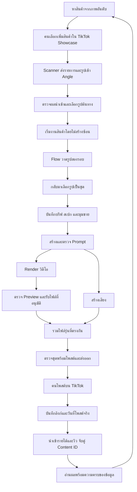

# Angle — แผนทั้งระบบและ Ticket สำหรับตรวจรับ

วันที่ 15 ตุลาคม 2026 · สถานะ **แผนหลัก เริ่มทำทีละ Ticket** · X05 และ X01 ทำแล้ว; ใบอื่นยังเป็นแผนสำหรับทบทวน

## 1. สิ่งที่จะได้จากแผนนี้

ครอบคลุมตั้งแต่คัดสินค้า จนผลิต โพสต์ และนำรายได้กลับมาช่วยเลือกงานครั้งถัดไป ผู้ใช้ยังเป็นคนเลือกสินค้า ตรวจภาพ/คลิป และโพสต์เอง ระบบลดงานซ้ำและบอกความคืบหน้าที่เชื่อถือได้

มี **60 Tickets**: 30 ใบใหม่ในเอกสารนี้ และ 30 ใบเดิมใน [แผนการผลิตและความน่าเชื่อถือ](angle-improvement-design-tickets.md) ไม่สร้าง Ticket ซ้ำเพื่อให้ทุกระบบมีฟีเจอร์ใหม่ ของที่ดีอยู่แล้วจะรักษาและตรวจ regression

ทุก Ticket มีเป้าหมายเดียว Flow ตัวอย่าง UAT และสิ่งที่ต้องทำก่อน แม้บางใบแตะหลายไฟล์ก็ต้องส่งมอบพฤติกรรมเดียว ทยอยตรวจรับได้ ไม่ต้องยอมรับทุกใบเพื่อเริ่มชุดแรก

**ฐานการตัดสินใจ:** CONTEXT, backlog, คู่มือระบบย่อย, ADR และโค้ดปัจจุบันมีน้ำหนักมากกว่าข้อความ Completed ในสองเอกสารต้นทาง วันที่นี้ยังไม่ได้รัน UAT ตามแผน ความเสี่ยงจากการอ่านโค้ดไม่ใช่การยืนยันว่าเกิดกับทุกงานจริง

### เส้นทางของผู้ใช้หลังปรับ

คำว่า “งานเสร็จ” แยกเป็นสี่เรื่อง: **บอทเสร็จ / ไฟล์พร้อม / ส่งออกแล้ว / โพสต์แล้ว** ไม่ใช้สถานะหนึ่งแทนทุกเรื่อง โดยเฉพาะ “ทำต่อเอง” ไม่ใช่โพสต์แล้ว

### สิ่งที่รักษาไว้

- แอป local ของเจ้าของคนเดียว ใช้ SQLite และ Flow ผ่าน UI บนบัญชีสำรองตาม ADR เดิม
- เป้าปัจจุบันสินค้าใหม่ 3–5 ตัวต่อวัน กลับมาเคลียร์ checkpoint วันละ 1–2 รอบ ไม่เปลี่ยนเป็นผลิตหลาย angle เป็นหลัก
- Showcase คือรายการงานที่เลือกแล้ว; Products คือรายการพิจารณา ไม่ย้ายสถานะเพราะสแกนซ้ำหรือหายจาก snapshot
- ใช้ sourceProductId รู้จักสินค้า, Content ID รู้จักคลิป และ duplicatedFromId รู้จักตระกูลทดลอง ไม่จับคู่ด้วยชื่อ
- Required hashtag เป็นข้อมูลคนใส่ ไม่ให้ Scanner ทับ และยังคัดลอกแยกจาก caption ไม่ยัดลงไฟล์โพสต์โดยอัตโนมัติ
- Prompt ต้องครบ 10 ส่วน ไม่แสดงข้อความบนภาพ ไม่เดาสเปก; สเปกที่คนแก้ไม่ถูก AI ทับเงียบ
- เส้นทาง manual, การทำต่อเอง และ Preview 720p ที่คนอนุมัติเมื่อ Final โหลดไม่ได้ ยังใช้งานได้พร้อมป้ายกำกับ
- แก้ UI ในหน้าเดิม ใช้ token/Base UI เดิม รักษาเลย์เอาต์ 1440px; ไม่สร้าง dashboard ใหม่ซ้ำกับทุกหน้า

## 2. แผนที่ระบบปัจจุบัน → สิ่งที่จะปรับ

| ระบบ | มีอยู่แล้ว | ช่องว่างที่ยืนยันจากโค้ด/สิ่งที่ต้องตรวจ | Tickets |
|---|---|---|---|
| หาสินค้า | OCR ภาพอันดับ แบ่ง batch/หมวด | คนต้องเห็นและแก้ค่าก่อนนำไปตัดสินใจ ไม่สร้าง Product ID เดา | S01 |
| Scanner/Showcase | token link, dedupe view, รูปจากร้าน, dismiss/restore, required tags | import สร้าง batch ก่อนโหลดรูป; ต้องแยกผลรับสินค้า/รูปและตรวจเริ่มซ้อน | S02–S05 |
| บรีฟและรูป | form state, บันทึกบางช่องแยก, คลังรูป | generate อ่าน DB; productSpec ใช้ต่อเมื่อไม่ว่างแม้รูปเปลี่ยน | P01–P02 |
| Prompt | multimodal, 10-part, manual, core/caption เวอร์ชัน | generation ยังเขียน output โดยไม่ตรวจ input เปลี่ยน; ต้องแยกประวัติ/validation/SEO retry | P03–P06 |
| ตัวอย่าง Prompt | golden pool คงที่ **สุ่ม 3 ตัวอย่าง** | ห้ามนำ output ล่าสุดกลับมาสอนอัตโนมัติ; เพิ่มตัวอย่างผ่าน review | P07 |
| Flow | lifecycle กลาง, recovery/circuit breaker, checkpoint | งานรอคนควรอ่านและจัดการเป็นชุด พร้อมป้องกันหน้าค้างกดผิดสถานะ | W01–W04, V01, O01–O02 |
| เสียง/รวมคลิป | มีโค้ด TTS, merge, auto paths | duration, error, รุ่นไฟล์, concurrency, export freshness | M01–M06, V02–V06, Q01–Q04 |
| ส่งออก/โพสต์ | โฟลเดอร์ตามวันโพสต์, clipboard, URL+postedAt | planned/actual ต้องชัด; URL ซ้ำหรือไม่เป็น TikTok ยังบันทึกได้; relink หลังวาง URL ยังขาด | H01–H04, V05 |
| รายได้/วิว | orders upsert, metric snapshot, import log, recommender | orders parser ใช้ชื่อหัวคอลัมน์แล้ว แต่ CSV ใช้ตำแหน่ง; import error ถูกกลบ; snapshot ทับกันได้ | D01–D04, R01–R03 |
| วงจรเรียนรู้ | factual angle outcomes และคำแนะนำบางส่วน | ต้องรู้ freshness/cost ก่อนเลือกงาน ไม่สร้างตัวชี้วัดเกินข้อมูล | D05, O03, I01–I02 |
| ปฏิบัติการ | start/stop, logging, pure checks, screenshots | sandbox ยังมีโอกาสแชร์ไฟล์จริง; backup/restore และ skill เลือก checks | X01–X05, B01–B03 |

ข้อแตกต่างจากเอกสารเดิมที่มีผลต่อแผน: ใช้พอร์ต 3050/3051; WAL ไม่รับประกันไม่มี lock; รวม top-15 หลายไฟล์ไม่รับประกันข้อมูลครบ; เปลี่ยนเป็น API ไม่ใช่เป้าหมาย; ไม่เพิ่ม auto-trash สินค้าและไม่ฟันธงตะกร้าหลุดใน 48 ชั่วโมง

## 3. ลำดับส่งมอบและการเลือกงาน

| ชุดตรวจรับ | เป้าหมาย | ใบที่เกี่ยวข้อง |
|---|---|---|
| 0 เครื่องมือทำงานปลอดภัย | แยก sandbox เลือก checks ถูก และสำรองได้ | X01, X05, B01–B02 |
| 1 งานหนึ่งตัวตั้งแต่ต้นถึงไฟล์ | ไม่เริ่มซ้อน ไม่ใช้ input/ไฟล์เก่า ไม่ทำภาพหรือเสียงขาด | S04, P01–P04, M01–M06, V01–V06 |
| 2 ไฟล์ถึงรายได้ | คัดลอกข้อมูลโพสต์ถูก วาง URL แล้วจับคู่ข้อมูลย้อนหลัง | H01–H04, D01–D04, R01 |
| 3 ผลิตเป็นชุดได้สะดวก | เสียง/ภาพคู่กัน กู้คิว และเคลียร์ checkpoint เป็นรอบ | Q01–Q04, W01–W04, S02–S03, S05 |
| 4 ปรับคุณภาพจากหลักฐาน | แก้ caption เฉพาะขั้น รู้รุ่น prompt/สาเหตุ redo/ต้นทุน | P05–P07, O01–O03, X02–X04, B03 |
| 5 ทางเลือกเมื่อข้อมูลพอ | คัดสินค้ามีข้อมูล ตรวจความเสี่ยง และพิจารณา angle | S01, D05, I01–I02, R02–R03, F01–F03 |

ลำดับในตารางคือชุดพฤติกรรมสำหรับ review ไม่ใช่คำสั่งทำเรียงรหัส ดู dependencies ของแต่ละใบก่อน เริ่มจาก X05 ที่เตรียมได้โดยไม่แตะแอปจริง และ X01/B01 ก่อน UAT ที่สร้างข้อมูลหรือสำเนารูป

**เงื่อนไขหยุดขยายฟีเจอร์:** ถ้ายังส่งออกคลิปปัจจุบันถูกต้องหรือ restore ไม่ผ่าน ให้แก้สิ่งนั้นก่อนลงทุน AI เพิ่ม และไม่ใช้สถิติรันจำลองแทนผลธุรกิจจริง

## 4. Tickets ใหม่ — หาสินค้าและ Showcase

### S01 — ตรวจและแก้ค่าที่อ่านจากภาพอันดับ

**Goal:** ตัวเลขที่คนใช้เลือกสินค้าตรงกับภาพต้นทาง

**Flow:** แนบภาพ → อ่านข้อมูล → ดูชื่อ/ราคา/ค่าคอม/ยอดขายพร้อมภาพ → แก้แถว → บันทึก batch

**ขอบเขต:** หน้าตรวจค่าก่อนยืนยันใน Products; ค่าว่างคงเป็นไม่ทราบ; แสดงหน่วยบาท/เปอร์เซ็นต์ชัด; ไม่มี Product ID ไม่เดาจากชื่อ; ไม่เพิ่มเข้าบัญชี TikTok ให้เอง

**UAT:** ภาพระบุราคา 199 แต่ AI อ่าน 1999 → แก้ 199 แล้วค่าที่แสดงคงอยู่หลัง refresh; ภาพไม่มียอดขาย → ไม่แสดง 0; ยกเลิกก่อนยืนยัน → ไม่สร้าง batch

**พึ่งพา:** X01 · **จุดแก้:** extractCandidates + Products review

### S02 — แยกผลนำเข้าสินค้าและผลโหลดรูป

**Goal:** สแกนสำเร็จบางส่วนแล้วผู้ใช้รู้ว่าเหลือแก้อะไร

**Flow:** Scanner ส่ง → รับสินค้า → โหลดรูป → “รับ 12 รายการ / 2 รายการรูปไม่ครบ” → เปิดรายการนั้น

**ขอบเขต:** บันทึก import receipt ใน Angle มี batch/time/status/count; API `showcase-scanner/1` คง fields เดิม ไม่เปลี่ยน payload ฝั่ง extension; คนดูรายละเอียดใน Angle; เน็ตขาดหลังรับข้อมูลต้องค้นผลรอบล่าสุดได้ ไม่ตีว่าสินค้าหาย

**UAT:** สินค้าเข้าแล้วแต่หนึ่งรูป timeout → สินค้ายังอยู่และเห็นรายการขาด; refresh → ผลรอบเดิมยังอ่านได้; นำเข้าสินค้าหมดสถานะไม่รองรับ → แสดง skipped พร้อมเหตุผล ไม่สร้างแถวปลอม

**พึ่งพา:** X01 · **จุดแก้:** import receipt, importShowcaseBatch และสถานะ Showcase

### S03 — เติมรูปที่นำเข้าไม่สำเร็จโดยไม่สร้างงานใหม่

**Goal:** กู้รูปที่ขาดโดยรักษา entry และงานเดิม

**Flow:** เปิดสินค้ารูปขาด → นำเข้าใหม่จาก Scanner หรือเลือกไฟล์เอง → รูปพร้อม → เลือกต้นทาง

**ขอบเขต:** ไม่พึ่ง URL ที่อาจหมดอายุและไม่ได้เก็บ; แสดงแหล่งที่มา; ใช้ downloader ที่มี SSRF/redirect/size guards เดิม; เติมรูปไม่เปลี่ยน source photo ของงานที่กำลังทำเงียบ ๆ

**UAT:** URL เก่าหมดอายุ → แนะนำสแกนใหม่/ไฟล์เอง ไม่ลองซ้ำไม่สิ้นสุด; เพิ่มรูปให้สินค้าที่กำลัง Render → job/input เดิมไม่เปลี่ยน; ไฟล์เกินขนาด → อธิบายและไม่เพิ่มไฟล์เสีย

**พึ่งพา:** S02, S05 · **จุดแก้:** shop photo recovery และ photo picker

### S04 — เริ่มสินค้าหนึ่งตัวครั้งเดียวแม้กดซ้ำ

**Goal:** กด “ทำคลิปตัวนี้” สองแท็บแล้วไม่เกิด entry/งานเปิดซ้อน

**Flow:** เลือกรูป → กดเริ่ม → จอง sourceProductId → สร้าง/คืน entry เดิม → เข้าคิว

**ขอบเขต:** จองเริ่มแบบ atomic ต่อสินค้า; linkedEntryId เป็น soft link เหมือนเดิม; enqueue พังต้องกลับมาเริ่มต่อที่ entry เดิม; กรณีทำซ้ำโดยเจตนาใช้ action ทำสำเนาแยก

**UAT:** ส่งสองคำขอพร้อมกันคนละ candidate row แต่ ID สินค้าเดียว → ได้ entry เดียวและงานเปิดเดียว; enqueue พัง → แสดง error และเริ่มต่อไม่สร้าง entry ใหม่; ชื่อเท่ากันคนละ ID → เริ่มได้แยกกัน

**พึ่งพา:** X01 · **จุดแก้:** startShowcaseProduct + start reservation transaction

### S05 — สแกนซ้ำแล้วสถานะงานไม่ย้อนกลับ

**Goal:** ข้อมูลร้านอัปเดตได้โดยสถานะที่คนตัดสินใจยังถูกต้อง

**Flow:** ทำงาน/ไม่ทำแล้ว/โพสต์แล้ว → สแกนสินค้าเดิม → แสดงสถานะเดิมพร้อมข้อมูลร้านรอบใหม่

**ขอบเขต:** resolver ต่อ sourceProductId เลือก linkage/dismiss/required tags จากหลักฐานเดิม ไม่อ้างแถวล่าสุดเพียงอย่างเดียว; ไม่ลบ entry เมื่อลบ batch; พบ soft link ไป entry ที่ลบแล้วแสดงกู้เริ่มใหม่ได้; ขาดสินค้าจาก snapshot ไม่เท่ากับเลิกทำ

**UAT:** dismiss แล้วสแกนใหม่ → ยังไม่ทำแล้ว; โพสต์แล้วสแกนใหม่ → ยังโพสต์แล้วและ tags อยู่; ลบ batch → คลิป/entry ยังอยู่; สินค้าไม่ปรากฏรอบใหม่ → ไม่ถูกตัดสินว่าหมดสต็อก

**พึ่งพา:** S04 · **จุดแก้:** showcase pure resolver + queries; เป็น regression fix เฉพาะจุดที่ทดสอบไม่ผ่าน

## 5. Tickets ใหม่ — บรีฟ รูป และ Prompt

### P01 — บันทึกค่าที่เห็นก่อนกดสร้าง Prompt

**Goal:** AI ได้บรีฟและ angle ล่าสุดที่ผู้ใช้เห็นบนจอ

**Flow:** แก้ข้อมูล → กดสร้าง → บันทึกช่องที่แก้/รอ autosave → เริ่ม AI → แสดงผล

**ขอบเขต:** รวมจังหวะ save form และ save ช่องแยก; รอ upload/caption/angle/safeMode ที่ค้าง; save ล้มเหลวไม่เริ่ม API; ไม่สร้าง autosave ทั่วแอปโดยไม่จำเป็น

**UAT:** แก้รายละเอียดแล้วกดสร้างทันทีไม่ blur → fake AI ได้รายละเอียดใหม่; angle save ล้มเหลว → เห็นให้ลองบันทึกและไม่มี API call; เปลี่ยน entry ระหว่าง pending → ไม่บันทึกทับอีก entry

**พึ่งพา:** X01 · **จุดแก้:** entry workspace, actions save contract

### P02 — บอกรูปหรือข้อมูลเปลี่ยนเมื่อสเปกอาจเก่า

**Goal:** ไม่ใช้สเปกเก่าต่อโดยผู้ใช้ไม่รู้ และไม่ทับสเปกที่คนแก้

**Flow:** เปลี่ยนรูป/ข้อมูลสินค้า → “สเปกมาจากข้อมูลก่อนหน้า” → ใช้ต่อโดยยืนยัน / สกัดใหม่แล้วเปรียบเทียบ

**ขอบเขต:** source fingerprint ของสเปก; แยกที่มา AI/manual; รูป auto-source เปลี่ยนเป็น auto-flow ตาม checkpoint แจ้ง source เปลี่ยนแต่ไม่สกัดซ้ำเอง; เสนอ diff ก่อน replace; ยืนยันใช้ต่อเก็บกับ fingerprint ใหม่

**UAT:** แก้สเปกเองแล้วเปลี่ยนรูป → ของเดิมอยู่และมีคำเตือน; ยกเลิกสกัดใหม่ → ไม่ทับ; เปลี่ยน caption รูป → ตรวจแหล่งข้อมูลเปลี่ยน; เปลี่ยน caption โพสต์ → ไม่เตือนสเปกเก่า

**พึ่งพา:** P01 · **จุดแก้:** spec provenance + spec panel

### P03 — ผล AI เก่าไม่ทับการแก้ไขใหม่

**Goal:** รอ AI แล้วแก้บรีฟหรือสร้างรอบใหม่ ผลเก่าไม่กลายเป็นผลปัจจุบัน

**Flow:** เริ่มรุ่น A → แก้เป็น B → A ตอบกลับ → เก็บประวัติ A / บอกให้สร้าง B

**ขอบเขต:** generation request snapshot และ input revision; publish แบบ compare-and-set รวมรูป/spec/angle/safeMode/core version; ไม่ทับ output ที่คนแก้ระหว่างรอ; generation ID ใช้กันกดซ้ำและอ้าง downstream

**UAT:** A ช้ากว่า B → ปัจจุบันเป็น B; คน paste prompt ระหว่าง AI รอ → AI ไม่ทับ; สร้างซ้ำ input เดิมขณะ pending → ไม่ยิงซ้ำ; เปิดหน้าประวัติยังอ่านผล A ได้

**พึ่งพา:** P02 · **จุดแก้:** generation record/revision, generateWithAI

### P04 — ตรวจโครงสร้าง Prompt ก่อนส่ง Render

**Goal:** Prompt ที่ขาดส่วนหรือไม่มีบทพากย์ไม่ไหลเข้าคิวอัตโนมัติ

**Flow:** ได้คำตอบ AI/วางมือ → ตรวจ 10 ส่วน+บท → ผ่านเข้าคิว / แสดงจุดที่ขาดให้แก้

**ขอบเขต:** validator กลางรับ Markdown headings รูปแบบที่ใช้อยู่; ครบสิบหัวข้อไม่ซ้ำตามลำดับ, มีบทที่สกัดได้และ timeline; ไม่รับรองว่าสินค้าในภาพถูก; ใช้ claim warnings เดิม ไม่เพิ่มกฎคำโฆษณาเอง; ไม่มี retry จ่าย API อัตโนมัติ; prompt เก่าดูได้แต่ต้องตรวจเมื่อสั่ง Render ครั้งใหม่

**UAT:** ขาดหัวข้อ 4 → เก็บ draft แต่ไม่ queue Render; manual prompt ครบ → ใช้ทาง manual ได้; 10 headings มีแต่เนื้อหาว่าง → ไม่ผ่าน; คำ “ห้ามมีข้อความ” ใน Negative Prompt ไม่ถูกตีว่าเป็นคำสั่งใส่ข้อความ

**พึ่งพา:** P03 · **จุดแก้:** validator + promptReady gate ทั้ง AI/manual

### P05 — สร้าง Caption ใหม่เฉพาะขั้นที่เสีย

**Goal:** SEO พังแล้วไม่ต้องสร้าง Prompt/เสียง/วิดีโอซ้ำ

**Flow:** Prompt พร้อม แต่ caption error → กดสร้าง caption ใหม่ → สำเร็จเฉพาะ caption

**ขอบเขต:** ใช้ caption kind/model เดิมและ generation snapshot ปัจจุบัน; action แยก; เปลี่ยน Prompt ระหว่างรอ → ไม่ทับ caption ใหม่; ไม่ผสม required tags; แก้ caption ไม่ invalidate audio

**UAT:** caption API error แล้ว retry → จำนวน call ten-part/TTS/Render ไม่เพิ่ม; Prompt เปลี่ยนระหว่างรอ → ไม่ publish caption เก่า; API ใช้ไม่ได้ → คนกรอกเองได้

**พึ่งพา:** P03 · **จุดแก้:** caption action, production panel

### P06 — เห็นและย้อนดู Prompt ที่ใช้กับคลิปจริง

**Goal:** อธิบายได้ว่าคลิปนี้ใช้ Core Prompt รุ่นใดและข้อมูลอะไร

**Flow:** เปิดคลิป → ดูรุ่นการสร้าง → เปิด Prompt/รุ่น core/caption ที่ใช้ → คัดลอกมาทดลองใหม่

**ขอบเขต:** generation provenance เก็บ snapshot core/caption content/version, model, brief/spec/reference IDs/hashes และ golden example IDs; active core ใหม่ใช้กับการสร้างครั้งถัดไปตามพฤติกรรมปัจจุบัน; ไม่อ้าง corePromptId ของ entry อย่างเดียว; ย้อนดูไม่เปลี่ยน active ทั้งระบบ

**UAT:** เปลี่ยน active core หลัง Render → คลิปเก่ายังแสดงรุ่นที่ใช้จริง; core/caption active แยก kind ยังอยู่; legacy ไม่รู้รุ่น → แสดงไม่ทราบ ไม่เดา

**พึ่งพา:** P03 · **จุดแก้:** generation provenance/history read model

### P07 — เพิ่ม Golden Example แบบตรวจแล้วเท่านั้น

**Goal:** ปรับคุณภาพ Prompt โดยไม่สอนความผิดซ้ำจาก output ของ AI

**Flow:** เลือกตัวอย่าง → ตรวจสินค้า/บท/โครงสร้าง → เพิ่มเข้าชุดตัวอย่างผ่าน code review → รัน regression fixtures

**ขอบเขต:** คง pool แบบ frozen และสุ่มสามตัวอย่างเดิม; ไม่เพิ่มปุ่ม auto-promote ตามยอดเงิน; เพิ่ม fixture ของสินค้ากลไก/ของเหลว/รูปมีโฆษณา; ตรวจ request composition/validator แบบไม่เรียก API ก่อน และแยกผลลองจริงที่มีค่าใช้จ่าย

**UAT:** entry รายได้สูงแต่บทผิด → ไม่เข้ากองอัตโนมัติ; เพิ่มตัวอย่างที่ยังไม่ครบ 10 ส่วน → check ไม่ผ่าน; สินค้าของเหลว → fixture มี package-led และไม่อาศัยการเทของเหลว

**พึ่งพา:** P04, P06 · **จุดแก้:** golden pool + prompt regression checks

## 6. Tickets ใหม่ — จัดงานประจำวันและ Flow

### W01 — เห็นงานที่ต้องกลับมาตัดสินใจในหน้าเดียว

**Goal:** กลับมาวันละ 1–2 รอบแล้วรู้ว่าต้องทำอะไรบ้าง

**Flow:** เปิดคิว Flow → “รอเลือกภาพ / รอตรวจคลิป / ต้องแก้ / กำลังทำ” → เปิดงาน → กลับรายการเดิม

**ขอบเขต:** เพิ่ม filter/count ในหน้า Flow เดิม เก็บ URL; group ตามสิ่งที่คนทำ ไม่สร้าง status ซ้ำใน DB; sort เก่าสุดที่รอคนก่อน; pagination/read model เบา ไม่ส่งทุกภาพ/DOM log ลง client

**UAT:** มี review_r1/r2/r3 อย่างละงาน → count และรายการตรง; refresh/back → filter/ตำแหน่งงานไม่หาย; งานจบแล้ว → ไม่ค้างในรอคน

**พึ่งพา:** W04 · **จุดแก้:** flow queries + Flow list

### W02 — เคลียร์ checkpoint ทีละงานโดยไม่กดผิดรุ่น

**Goal:** เลือกภาพจากหน้าค้างไม่ได้ทำงานรุ่นใหม่เสีย

**Flow:** เปิด checkpoint → เลือก → server ตรวจ job/status/attempt/image → สำเร็จไปงานรอถัดไป / บอกข้อมูลเปลี่ยน

**ขอบเขต:** ไม่ auto-approve ทั้งชุด; ใช้ lifecycle เดิมและ optimistic guard; รูปที่เลือกต้องอยู่รอบ/attempt ที่แสดงและเป็นสินค้านี้; กดซ้ำไม่เพิ่มรอบ/เครดิต

**UAT:** เปิดสองแท็บแล้วแท็บแรก redo → แท็บเก่าเลือกภาพไม่ได้พร้อมเหตุผล; เลือกสำเร็จ → เห็นงานถัดไปโดยไม่ย้อนหน้ารวม; กลับหน้าเดิม → รูปที่เลือกคงอยู่

**พึ่งพา:** W01 · **จุดแก้:** checkpoint actions + lifecycle DB guards

### W03 — งานสะดุดมีคำแนะนำตรงกับเหตุ

**Goal:** คนรู้ว่าจะรอ ลองใหม่ ทำต่อเอง หรือแก้ล็อกอิน

**Flow:** เกิดเหตุ → ป้ายสาเหตุ+เวลารอ/ปุ่มที่ใช้ได้ → เลือกแก้ → คิวเดินตามกติกาเดิม

**ขอบเขต:** read model ใช้ errorKind และ recovery schedule เดิม; captcha/login/selector ไม่ retry ถี่; ไม่เพิ่มช่องทางส่งข้อความภายนอก; aggregate ในแอปไม่เตือนซ้ำทุก refresh; production log อ้างอิงสั้นไม่เปิดเผย token

**UAT:** captcha → ไม่เสนอ retry อัตโนมัติ; network circuit breaker → เห็นเวลาลองถัดไป; โหลด Final พัง → เห็นลองโหลดใหม่หรือใช้ approved preview; TTS พัง → ไม่บอกให้ล็อกอิน Flow

**พึ่งพา:** W04, M05 · **จุดแก้:** friendly job messages + recovery view

### W04 — แยกบอทเสร็จกับพร้อมโพสต์

**Goal:** งานที่ทำต่อเองหรือยังไม่มีไฟล์ไม่ถูกอ่านว่าพร้อมลงคลิป

**Flow:** บอทจบ/ทำต่อเอง → แสดงสถานะไฟล์แยก → ส่งออก → วาง URL → โพสต์แล้ว

**ขอบเขต:** derive BotState/MediaReadiness/ExportState/PostingState แยก; ไม่แก้ Flow done semantics ของ takeover; V06 เป็นเจ้าของความพร้อมไฟล์ ส่วนใบนี้เชื่อมไป Flow/Showcase/list; legacy ไม่มีหลักฐานให้แสดงไม่ทราบ

**UAT:** takeover ไม่มีคลิป → “ทำต่อเอง” และยังไม่พร้อม; export สำเร็จไม่ใส่ URL → ยังไม่โพสต์; URL มีแต่ไม่มี Prompt → ยังเป็นโพสต์แล้วตามกฎเดิม

**พึ่งพา:** V06 · **จุดแก้:** shared production summary + existing page queries

## 7. Tickets ใหม่ — ส่งออกและบันทึกการโพสต์

### H01 — ตรวจข้อมูลที่จะใช้ตอนโพสต์ในแผงเดียว

**Goal:** หยิบคลิปถูกและไม่ลืม Product ID/แฮชแท็กที่ต้องลง

**Flow:** เปิดชุดส่งออก → ดูรุ่นคลิป+Product ID+caption+required tags → คัดลอกแต่ละส่วน → โพสต์เอง

**ขอบเขต:** ใช้ clipboard เดิมพร้อม fallback; required tags แยกจาก generated hashtags ชัดเจน; ไม่ auto-write tags ลงโพสต์.txt หรือ entry; ไม่สร้าง publish API

**UAT:** สินค้ามี required tags → เห็นและคัดลอกได้โดยค่าที่สร้างจาก AI ไม่เปลี่ยน; ไม่มี Product ID → แสดงไม่ทราบไม่เดาจากชื่อ; clipboard fail → มีทางเลือกข้อความให้คัดลอกเอง

**พึ่งพา:** V05, S05 · **จุดแก้:** posting details ใน entry/Flow เดิม

### H02 — บันทึกลิงก์คลิปที่จับคู่รายได้ได้และไม่ซ้ำ

**Goal:** หนึ่ง Content ID ไม่ผูกกับสอง entry โดยไม่รู้ตัว

**Flow:** วาง TikTok URL เต็ม → normalize Content ID → ตรวจเจ้าของเดิม → บันทึก / เปิด entry ที่มีแล้ว

**ขอบเขต:** ใช้ parser กลาง allowlist hostname TikTok จริง+numeric video ID; query/fragment ไม่เปลี่ยน identity; short link ขอ full video URL โดยไม่ fetch redirect อัตโนมัติ; เพิ่ม nullable normalized videoId และ unique เมื่อ audit ของซ้ำเดิมเสร็จ; conflict เดิมไม่ย้ายข้อมูลอัตโนมัติ

**UAT:** สองแท็บผูก ID เดียวต่าง entry → หนึ่งคำขอสำเร็จ อีกคำขออธิบาย; URL เดิมเพิ่ม query → เป็นคลิปเดียวกัน; evil-tiktok hostname/URL ทั่วไป → ไม่ผ่าน; legacy link ยังเปิดดูและแก้ได้ ไม่ทำหาย

**พึ่งพา:** X01; audit duplicate ก่อน unique migration · **จุดแก้:** production action + canonical video identity

### H03 — วางหรือแก้ลิงก์แล้วจับคู่ข้อมูลย้อนหลังทันที

**Goal:** ไม่ต้องอัปโหลดรายได้/วิวใหม่เพื่อให้ข้อมูลที่มีแล้วผูกคลิป

**Flow:** import ก่อน URL → ยังไม่จับคู่ → บันทึก URL → rematch orders/metrics → Dashboard อัปเดต

**ขอบเขต:** transaction บันทึก identity + relink เฉพาะ old/new Content ID; ไม่จับคู่ด้วย productName; URL เปลี่ยนต้องปลดของ ID เก่าที่เคยผูก entry นี้; action ลบ entry คง SetNull เดิม; refresh เฉพาะ routes ที่ได้รับผล

**UAT:** มี order+metric ก่อนวาง URL → วางแล้วติดทั้งคู่ทันที; A เปลี่ยน URL เป็น B → orders A ไม่ปน B; duplicate conflict → ไม่มีการย้าย ownership บางส่วน; เงินรวมทั้งช่องไม่เพิ่มเพราะ relink

**พึ่งพา:** H02 · **จุดแก้:** identity reconciliation transaction + import callers

### H04 — แยกวันที่วางแผนกับวันที่โพสต์จริง

**Goal:** โฟลเดอร์วันโพสต์ไม่กลายเป็นประวัติโพสต์จริง

**Flow:** export ไปพรุ่งนี้ → แสดงวันแผน → โพสต์จริงวันอื่น → กรอกวันที่จริง → ประวัติถูกต้อง

**ขอบเขต:** แสดง planned date จาก export record เดิมเท่าที่มี; postedAt คือวันที่จริง UTC midnight ตามเดิม; มี URL ไม่มีวันที่ให้บอกยังไม่ระบุ; ไม่เปลี่ยนวันเก่าเองจาก createdAt/ชื่อ folder

**UAT:** export วันที่ 16 แต่โพสต์ 17 → แผน16/จริง17; สร้างงานก่อน 07:00 ไทย → วันที่ไม่เลื่อนย้อนหลัง; ไม่มี URL แต่มีวันแผน → ยังไม่โพสต์; วัน31ในเดือนที่ไม่มี → server ปฏิเสธ

**พึ่งพา:** H02, V05 · **จุดแก้:** production dates + posting summary

## 8. Tickets ใหม่ — นำเข้าข้อมูลและปิดวงจรธุรกิจ

### D01 — CSV เปลี่ยนคอลัมน์แล้วไม่อ่านสลับ

**Goal:** วิว/ไลก์/วันที่ไม่ถูกอ่านเป็นคนละช่องเงียบ ๆ

**Flow:** เลือก Content.csv → ตรวจหัวคอลัมน์ → parse/validate → ยอมรับ / แจ้งหัวข้อที่ขาด

**ขอบเขต:** resolve จากชื่อใน fixture จริงและ aliases ที่ยืนยันแล้วแทน index; ใช้ csv parser เดิม; missing/invalid number แยกจาก explicit 0; ค่าวิวเสียไม่เขียน 0 ทับ; ไม่เดาช่วง 7/28/60 จากชื่อไฟล์

**UAT:** สลับคอลัมน์ใน fixture → ตัวเลขเท่าเดิม; ขาด Views → ไม่ import ไฟล์นั้นและบอกเหตุ; `0` จริง → เก็บ 0; ค่าว่างผิด format → ไม่ทำลาย snapshot เดิม

**พึ่งพา:** X01 · **จุดแก้:** clip-metrics parser + schema fixtures

### D02 — Import สำเร็จต้องหมายถึงข้อมูลทั้งไฟล์ลงครบ

**Goal:** รู้ว่าไฟล์ใดสำเร็จ/พังและไม่เหลือข้อมูลครึ่งไฟล์ที่ดูเหมือนสำเร็จ

**Flow:** เลือกไฟล์ → parse ทุกแถว → validate → transaction ต่อไฟล์ → receipt สรุปผล

**ขอบเขต:** orders parser ใช้ header อยู่แล้ว รักษาไว้และส่ง error ที่อ่านได้แทน generic catch; parse error แสดงจำนวน/เหตุ; file ที่ไม่ผ่านไม่เขียน; หลาย CSV แยกผลแต่ละไฟล์; import log success เขียนใน transaction เดียวกับ rows; API/file data ไม่ถูกพิมพ์ทั้งก้อน

**UAT:** DB error กลางไฟล์ → rollback ไฟล์และไม่มี log success; สาม CSV พังหนึ่ง → อีกสองสำเร็จพร้อมผลแยก; อัปไฟล์เดิม → เตือนแต่ยังเลือกนำเข้าซ้ำได้และจำนวน order/snapshot ไม่พอง

**พึ่งพา:** D01 · **จุดแก้:** orders/clips import transactions + receipt view

### D03 — รวม snapshot วันเดียวโดยไม่ขึ้นกับลำดับอัป

**Goal:** สลับลำดับไฟล์ช่วงเวลาซ้อนกันแล้วไม่เปลี่ยนตัวเลขโดยไม่มีเหตุผล

**Flow:** อัปไฟล์ช่วง A+B → เก็บ provenance → ตรวจค่าคลิปเดียววันเดียว → รวม / แสดง conflict

**ขอบเขต:** ตรวจ fixture จริงก่อนว่าตัวเลข cumulative หรือเฉพาะช่วง; เก็บ source hash/date/window ที่ยืนยันได้; ค่าเท่ากันยุบซ้ำได้; ค่าต่างและไม่ยืนยัน semantics → เก็บสอง source เป็น conflict ไม่ทับ canonical โดย last-write; ผู้ใช้ดูหลักฐานและเลือก source ได้; ห้ามใช้ max อัตโนมัติก่อนพิสูจน์ว่าเป็น cumulative เดียวกัน

**UAT:** อัป A→B เทียบ B→A → canonical และ conflict เหมือนกัน; แถวเหมือนกัน → snapshot เดียว; เลขต่างไม่ทราบช่วง → แสดง conflict และไม่สร้าง delta/RPM จากแถวนั้นจน resolve; วันคนละวันยังเป็นสอง snapshot

**พึ่งพา:** D02 · **จุดแก้:** metric source provenance + merge policy

### D04 — รายการจับคู่ไม่ได้มีทางแก้ชัดเจน

**Goal:** รายได้หรือวิวที่ยังไม่ผูก entry ไม่หายจากสายตา

**Flow:** import → ดู unmatched ตาม Content ID → ผูกกับ entry ผ่าน URL หรือสร้าง entry ขั้นต่ำ → rematch

**ขอบเขต:** ต่อจาก createEntryFromOrder เดิม; รวมทั้ง metric-only ที่ยังไม่มี order; ไม่สร้าง entry อัตโนมัติจากทุกแถว; ชื่อเป็นคำแนะนำแสดงผลไม่ใช่ identity; วิดีโอไม่มี contentId เก็บสรุปต่างหากไม่รวมเป็นคลิปเดียว

**UAT:** metric มี ID แต่ไม่มี order → เปิดให้ผูกได้; เลือก entry ที่มีอีก ID อยู่ → ต้องแก้ผ่าน H02 ไม่ overwrite เงียบ; relink แล้ว unmatched ลดแต่เงินรวมไม่เปลี่ยน

**พึ่งพา:** H03, D02 · **จุดแก้:** dashboard unmatched view + existing create/relink actions

### D05 — จากผลรายได้ไปยังงานที่คนเลือกทำต่อ

**Goal:** ดูผลแล้วตัดสินใจครั้งถัดไปได้โดยไม่ผลิตงานอัตโนมัติเกินต้องการ

**Flow:** อ่านคลิปกำลังโต/ขายได้ → ดูหลักฐาน+ความสด → เปิดสินค้าหรือบันทึกเหตุผล → คนเลือกงานถัดไป

**ขอบเขต:** ใช้ recommender เดิมก่อน ไม่สร้างคะแนนรวมลึกลับ; action เปิด entry/Showcase ที่สัมพันธ์ด้วย ID; รายได้ชำระแล้วกับรอแยก; คลิปใหม่หรือข้อมูลขาดไม่มีป้ายล้มเหลว; ไม่ auto-select สินค้าหรือ auto-duplicate angle

**UAT:** recommendation อ้างคลิปหนึ่ง → เปิด entry ถูกแม้ชื่อซ้ำ; ข้อมูลเก่า → เห็นอายุก่อนคำแนะนำ; เลือกดูหลักฐาน → ไม่สร้างงาน Flow/เรียก AI เพิ่ม

**พึ่งพา:** D04, R01, O02; ใช้ O03/R02 เพิ่มเมื่อพร้อม · **จุดแก้:** recommendations navigation + outcome context

## 9. Tickets ใหม่ — การดูแลระบบและเครื่องมือของ agent

### X01 — Sandbox แยกทั้ง DB และไฟล์

**สถานะ:** Implemented 15 ต.ค. 2026 · วิธีใช้งานและข้อจำกัด: [Sandbox](sandbox.md) · ตรวจด้วย `node scripts/check-sandbox.mjs`, type/lint, Flow/media checks และเปิดหน้าแอปบน3051 (1440px) · รอผู้ใช้ลอง UAT ด้วยตนเอง

**Goal:** ทดสอบแล้วรูป/คลิป/config/โฟลเดอร์ส่งออกของผู้ใช้ไม่เปลี่ยน

**Flow:** สร้าง sandbox → snapshot DB → copy ไฟล์ที่จำเป็น → ตั้งทุก root → เปิด3051 → ทดสอบ

**ขอบเขต:** override upload root ผ่าน upload-paths ตัวเดียว รวม candidates/failures; config/export/backup/profile root แยก; worker ไม่เริ่มอัตโนมัติใน sandbox; startup check ถ้า DB ทดสอบแต่ root ชี้ production ปฏิเสธ mutation; snapshot DB ใช้ SQLite backup ที่อ่าน live ได้ ไม่ใช้ copy WAL หลายไฟล์ระหว่างเขียนแล้วรับรองว่าครบ

**UAT:** เปลี่ยนรูป/ลบ fixture ใน sandbox → checksum production roots ไม่เปลี่ยน; ตั้ง dev-test DB แต่ upload root จริง → ปฏิเสธก่อนเขียน; export fixture → อยู่ sandbox ไม่ออก Desktop TTS

**พึ่งพา:** ไม่มี; B02 ใช้ isolation ใบนี้ ไม่ implement อีกชุด · **จุดแก้:** storage/runtime root configuration + sandbox preparation

### X02 — ดูสุขภาพระบบโดยไม่รบกวนบอท

**Goal:** แยกได้ว่าเว็บเปิดแต่ worker หยุดหรือ dependency ไม่พร้อม

**Flow:** เปิดตั้งค่า → ดู server/Flow heartbeat/media heartbeat/FFmpeg/storage → ไปวิธีแก้

**ขอบเขต:** รวม health ที่มี ไม่ยิง Generate/ล็อกอิน/Google request เพื่อเช็ก; ไม่แสดง token/key/full env; ตรวจ network binding ว่าตรงขอบเขต local ตาม ADR และรายงานเมื่อเปิดกว้าง ไม่เปลี่ยนการเข้าถึงเองโดยไม่มีหลักฐานความต้องการ; heartbeat เก่าบอกไม่ทราบ/หยุด ไม่อ้างว่า process ยังรันจาก PID file อย่างเดียว

**UAT:** server live แต่ Flow heartbeat เก่า → ไม่แสดงทุกอย่างพร้อม; ไม่มี FFmpeg → เห็นเฉพาะ media ไม่พร้อม; หน้ารายงานไม่มีความลับและเปิดแล้วไม่เพิ่ม FlowActivity generate

**พึ่งพา:** M01, Q04 · **จุดแก้:** read-only health summary/settings

### X03 — ตรวจไฟล์กำพร้าก่อนคิดลบ

**Goal:** รู้พื้นที่ที่อาจเก็บกวาดได้โดยไม่ทำหลักฐาน/คลิปหาย

**Flow:** scan read-only → รายงาน reference/ไม่พบ reference/ไฟล์หาย → คนตรวจ → ล้างเฉพาะ temp ที่ระบุในขั้นถัดไป

**ขอบเขต:** รุ่นแรกทำรายงานเท่านั้น; trace references ทุก entry/job/asset/export ก่อนระบุ orphan; path อยู่ใต้ root ที่อนุญาต; ไม่ auto-trash รูปเก่าที่ไม่ chosen เพราะเป็นคลังรูป; retention ลบจริงเป็น Ticket แยกเมื่อรู้ขนาดและกู้คืนได้

**UAT:** รูป redo ไม่ chosen แต่มีแถวคลัง → ไม่เป็นขยะ; legacy ไม่รู้ที่มา → รายงานตรวจเพิ่มไม่แนะนำลบทันที; scan แล้วไม่มีไฟล์ถูกลบ

**พึ่งพา:** V01–V03, B02 · **จุดแก้:** read-only storage audit script

### X04 — ส่งมอบแต่ละชุดพร้อมทางถอย

**Goal:** เปลี่ยนระบบโดยผู้ใช้ยังทำงานประจำต่อได้และรู้วิธีแก้เมื่อปล่อยแล้วมีปัญหา

**Flow:** ตรวจ sandbox+UAT → สรุปสิ่งเปลี่ยน → backup ตรวจแล้ว → ผู้ใช้หยุด/อัปเดตจริง → smoke แบบไม่เสียเครดิต → เปิดใช้งาน

**ขอบเขต:** additive migrations ก่อนเปลี่ยน reader/writer; legacy reader รองรับไฟล์เก่า; feature flags สำหรับ workflow ใหม่; rollback โค้ดไม่ใช่ย้อน DB อัตโนมัติ; schema/client version ตรวจให้ตรง; ห้าม restore backup เก่าทับงานใหม่โดยไม่ประเมินข้อมูลช่วงหลัง; build เต็มเมื่อ3050ว่างเท่านั้น

**UAT:** ปิด flag งานใหม่ → legacy entry ยังเปิดได้; client/schema ไม่ตรง → แจ้งก่อนเริ่ม worker; จำลอง rollback บน sandbox → งานก่อนหน้าอ่านได้และไม่มี migration ลบข้อมูล

**พึ่งพา:** X01, B02; เป็น checklist gate ของแต่ละชุด ไม่ต้องรอทุก Ticket เสร็จ · **จุดแก้:** release checklist/runbook

### X05 — Skill เลือกสคริปต์ตรวจตามระบบที่แก้

**Goal:** agent ใช้คำสั่งตรวจซ้ำได้ถูกต้องโดยไม่เดาคำสั่ง/แตะ production

**Flow:** agent แก้ระบบหนึ่ง → ใช้ skill → ดูแผน checks → รัน pure checks ที่เกี่ยวข้อง → รายงานผ่าน/ไม่ผ่าน/ยังไม่ตรวจ

**ขอบเขต:** skill discoverable `angle-checks` + helper ใน repo; helper default แสดงแผน ต้อง `--run` จึงรัน; allowlist เฉพาะ type/lint/pure checks ไม่รับ shell command อิสระ; DB/UI/live Flow/build แยก workflow และอ่าน AGENTS ก่อนเสมอ; reuse scripts เดิม ไม่มี duplicate tests

**UAT:** area=flow → มี type/lint และชุด Flow เดิม; area=theme → มี contrast; argument ไม่รู้จัก → nonzero ไม่รัน; dry-run → ไม่เรียก checks; ไม่มี build/migration/production DB/live API ในทุก area

**พึ่งพา:** ไม่มี · **จุดแก้:** scripts/agent-checks.mjs + skill ส่วนตัว; **สถานะ:** เตรียมแล้ว 15 ต.ค. 2026 ผ่าน `node scripts/check-agent-checks.mjs`, helper baseline `--run` (type/lint), ESLint ไฟล์ helper และ skill-creator quick_validate; ไม่ได้รันทุก area หรือ UAT ของแอปจากการตรวจนี้

## 10. วิธีใช้ 30 Tickets เดิมร่วมกับแผนหลัก

รายละเอียด Goal/Flow/UAT ของทุกใบอยู่ใน [เอกสารเดิม](angle-improvement-design-tickets.md) ใช้รหัสเดิมได้ทันที ไม่ต้องคัดลอกไปเกิดสองเจ้าของ

| กลุ่ม | รหัส | หน้าที่ในระบบทั้งหมด |
|---|---|---|
| เสียง/สื่อ | M01–M06 | ตรวจ dependency/duration/file/error/config |
| รุ่นสื่อ | V01–V06 | เก็บไม่ทับ lineage ไฟล์ รวมไม่ชน ส่งออกล่าสุด ตรวจโดยคน |
| งานเบื้องหลัง | Q01–Q04 | คิวสื่อ ทำคู่กับ Flow รวมเมื่อพร้อม และ recovery |
| สำรอง | B01–B03 | snapshot/gู้ใน sandbox/สถานะสำรอง |
| ข้อมูลการทำงาน | O01–O03 | เหตุผล redo เวลาเครื่อง/รอคน และต้นทุนโดยประมาณ |
| ทางลัด | F01–F03 | ใช้ภาพเดิมเฉพาะคนเลือก ไม่เปลี่ยนเป้าสินค้าใหม่ |
| AI ช่วย | I01–I02 | แนะนำวิธีลดเพี้ยน ช่วยชื่อเฉพาะจำเป็น |
| รายได้ | R01–R03 | freshness/coverage, angle outcome ตาม window, เตือนให้ตรวจสินค้า |

**ข้อกำหนดเชื่อมต่อที่ใช้ร่วมกัน:**

- P03 เป็นเจ้าของ generation revision; V02 อ้าง generation/script revision เดียวกัน ไม่สร้างการนับรุ่นบทสองระบบ
- V04 เตรียม task identity/atomic publish; Q01 เพิ่ม queue runner/lease บนโครงเดียวกัน ไม่สร้าง task table อีกชุด
- W04 อ่าน readiness จาก V06; H01 ใช้ export manifest ของ V05; ไม่มีป้าย ready ที่คำนวณเองคนละหน้า
- H02/H03 เป็นที่เดียวสำหรับ video identity/rematch; import ทุกตัวเรียก shared matching เดียวกัน
- D03 เป็นเจ้าของ provenance/semantics ของ metric; R02 ห้ามสร้าง RPM จนระบุ window ที่เทียบกันได้
- X01 เป็นเจ้าของ isolation; B02 กับ UAT ทุกระบบใช้ configuration เดียวกัน
- approved Preview fallback ต้องผ่านการตรวจโดยคนเหมือน Final และแสดงขนาดจริง ไม่ downgrade เงียบ

## 11. สัญญาข้อมูลที่ต้องเพิ่มและความเข้ากันได้

| สัญญา/ชนิดข้อมูล | ใช้ตอบอะไร | เจ้าของ |
|---|---|---|
| Import receipt + image outcomes | รอบนี้รับอะไรแล้ว/รูปใดขาด | S02 |
| Product start reservation | คำขอซ้ำควรกลับไป entry ไหน | S04 |
| Generation snapshot + revision/provenance | Prompt ใช้ input และ template รุ่นไหน | P02–P03, P06 |
| Prompt validation result | ผ่าน/ไม่ผ่านและตำแหน่งแก้ | P04 |
| MediaAsset/MediaTask + input fingerprint | ไฟล์ใดปัจจุบัน งานใดต้องกู้ต่อ | V02–V04, Q01 |
| Production summary แบบ read-only | บอท/สื่อ/ส่งออก/โพสต์ต่างกันอย่างไร | V06, W04 |
| Canonical video identity | หนึ่ง Content ID ผูก entry เดียว | H02–H03 |
| Metric source provenance + conflicts | snapshot มาจากช่วงใด น่าใช้หรือไม่ | D03 |
| Root configuration | DB/รูป/config/export แยกจริงหรือไม่ | X01 |

mutation ยังอยู่ Server Actions และ revalidate เฉพาะ route ที่กระทบ; worker เรียกโมดูลที่ไม่มี next/*; Scanner protocol v1 คงเดิมถ้าไม่มีความจำเป็นต้องเปลี่ยน; legacy unknown แสดงไม่ทราบ ไม่ backfill สาเหตุ/เวลา/รุ่นจากการเดา

ส่วนขยาย `showcase-extension` มี test runner และ package ของตัวเอง ต่างจากแอปหลักที่ใช้ check scripts อย่าใช้กฎ “ไม่มี test runner” ครอบ extension ถ้าแก้ protocol ต้องตรวจฝั่งส่ง/รับและคู่มือพร้อมกัน

## 12. UAT ทั้งระบบที่ผู้ใช้ตรวจเห็นภาพได้

ใช้ sandbox DB+uploads+config+export root จริงแยกทั้งหมด (X01) กับพอร์ต3051; fake Gemini/Flow ก่อน; smoke จริงที่ต้องใช้บัญชี/เครดิตระบุแยก ไม่เปิดบอททดสอบใช้โปรไฟล์เดียวกับบอทจริง

| Scenario | ลองทำ | ผลผ่านที่ต้องเห็น | Tickets |
|---|---|---|---|
| E01 คัดสินค้า | OCR อ่านราคาผิด แก้แล้วบันทึก | รายการพิจารณาใช้ค่าที่แก้ ไม่มี ID เดา | S01 |
| E02 สแกนเข้าไม่ครบรูป | ส่ง12สินค้า รูปพัง2 → เปิดแอป | รู้ว่ารับแล้ว12 เห็น2ที่ต้องแก้ สแกนซ้ำไม่รีเซ็ตสถานะ | S02–S05 |
| E03 กดเริ่มสองแท็บ | สินค้าIDเดียวกัน กดพร้อมกัน | entryและงานเปิดเดียว ชื่อเหมือนคนละIDไม่ชน | S04 |
| E04 รูป/สเปกเปลี่ยน | คนแก้สเปกแล้วเปลี่ยนรูป | สเปกไม่หาย มีแจ้งให้ทบทวนและเลือกใช้ต่อ | P02 |
| E05 AI เก่าตอบช้า | สร้างA แก้บรีฟB สร้างB แล้วAตอบ | Bเป็นปัจจุบัน Aเป็นประวัติ ไม่ไหลเข้า Render | P01–P04 |
| E06 API ล่ม | สร้างอัตโนมัติไม่ได้ → paste Prompt เอง | ตรวจแล้วทำต่อได้ ไม่บังคับจ่าย/เรียกAIใหม่ | P04–P05 |
| E07 เคลียร์งานเป็นชุด | มีรอเลือกภาพ3 รอตรวจคลิป2 | เห็นรายการครบ เคลียร์ทีละงาน หน้าค้างกดผิดรุ่นไม่ได้ | W01–W03 |
| E08 ภาพพร้อมเสียงล้ม | Renderเสร็จ TTS error | รู้ว่าเสียที่เสียง ลองเฉพาะเสียง ไม่สร้างภาพซ้ำ | M05, Q02–Q04 |
| E09 เสียงสั้น/ยาว | ภาพ10sเสียง6s; อีกงานเสียง20s | งานแรกภาพครบ งานหลังขอแก้บท ไม่ตัดคำ | M02–M04 |
| E10 เริ่มงานใหม่ในentryเดิม | คลิปAเสร็จแล้วสร้างB | Aไม่ถูกทับและmergeAไม่กลายเป็นB | V01–V04 |
| E11 Finalโหลดไม่ได้ | คนผ่านPreviewแต่โหลด1080pพัง | retryได้ หรือคนเลือกใช้720pชัดเจน ไม่ติดทางตัน | W03, V06 |
| E12 เปลี่ยนเสียงหลังexport | exportA → เสียงB → exportใหม่ | ไฟล์ปลายทางB ชุดที่ล้มเหลวไม่แจ้งพร้อม | V05, H01 |
| E13 โพสต์จริงวันอื่น | แผน16/โพสต์17 → ใส่URLและวันที่17 | แผนกับจริงไม่ปน ไม่มีIDซ้ำในสองentry | H02, H04 |
| E14 รายได้มาก่อนURL | importแล้ววางURLทีหลัง | จับคู่order+metricทันทีไม่ต้องimportซ้ำ เงินรวมเท่าเดิม | H03, D04 |
| E15 CSVเปลี่ยนรูปแบบ | สลับคอลัมน์ ขาดคอลัมน์ แถวเลขเสีย | อ่านถูกหรือบอกเหตุ ไม่เขียน0ทับและไม่ค้างครึ่งไฟล์ | D01–D02 |
| E16 ช่วงวิวขัดกัน | uploadA→B กับB→Aคลิปวันเดียว | ได้ผลเท่ากันหรือconflictชัด ไม่จัดอันดับจากข้อมูลขัดกัน | D03, R01–R02 |
| E17 ข้อมูลเก่า | orderเก่า+viewsใหม่ไม่มีออเดอร์ | เตือนข้อมูลก่อน ไม่ฟันธงตะกร้าหลุด | R01–R03 |
| E18 สำรอง/กู้/รีสตาร์ต | backupขณะใช้ → restoreที่3051; kill media worker | งานกู้ได้ ข้อมูลจริงไม่เปลี่ยน ไม่ยิงAPIซ้ำแบบไม่รู้ผล | X01, B01–B03, Q04 |
| E19 งานทำเอง | takeoverไม่มีคลิป → ส่งวัตถุดิบ → วางURL | ทำต่อได้ตลอด ไม่เรียกพร้อมโพสต์ก่อนมีหลักฐาน | W04, V06 |
| E20 กลับไปเลือกงาน | recommendation → เปิดสินค้าที่อ้างถึง | ถูกIDแม้ชื่อซ้ำ ไม่มีการสร้างงาน/เรียกAIเอง | D05 |

แต่ละชุดแนบผลผ่าน/ไม่ผ่าน/ยังไม่รัน แยก mock กับ live, fixture/ชื่อรุ่น, duration/checksum เมื่อเกี่ยวกับสื่อ และภาพหน้าจอ 390/820/1440px เมื่อแก้ UI มี touch context ต่ำกว่า1024px และไม่มี horizontal overflow

ห้ามสรุป “ทดสอบครบแล้ว” จาก type/lint อย่างเดียว; ไม่รัน build เต็มขณะ3050ถูกใช้งาน; migration DBจริงเป็นการรันโดยผู้ใช้; การอ่านไฟล์/การทำแผนนี้ไม่ใช่ผล UAT

## 13. สิ่งที่ผู้ใช้เลือกเปลี่ยนได้และขอบเขตที่ยังไม่ทำ

ค่าเริ่มเสนอ: ตรวจคลิปรวมหนึ่งครั้ง, tempoสูงสุด1.25, ไม่มีAPI retryที่อาจจ่ายซ้ำเมื่อไม่รู้ผล, คนอนุมัติ720pได้เมื่อFinalมีปัญหา, required tagsคัดลอกแยก, เริ่มสินค้าใหม่มากกว่าทำangleซ้ำ และรายงานสถานะอยู่ในแอปก่อน

ยังไม่เพิ่ม auto-post, auto-select/auto-trashสินค้า, หลายบัญชี/หลายเครื่อง, ย้ายDB, ส่งข้อความภายนอก หรือวิเคราะห์ความสัมพันธ์จากวิวที่ยังไม่ครบ หากต้องการสิ่งเหล่านี้ให้ทำ design แยกตามเป้าธุรกิจ

**วิธี review:** อ่านภาพรวมข้อ1 → เลือกชุดส่งมอบข้อ3 → ดูFlow/UATของใบที่สนใจ → ระบุรหัสใบที่เห็นด้วย/อยากแก้ ไม่ต้องอ่านรายละเอียดสื่อ30ใบซ้ำเพื่อเข้าใจ Master Plan นี้
